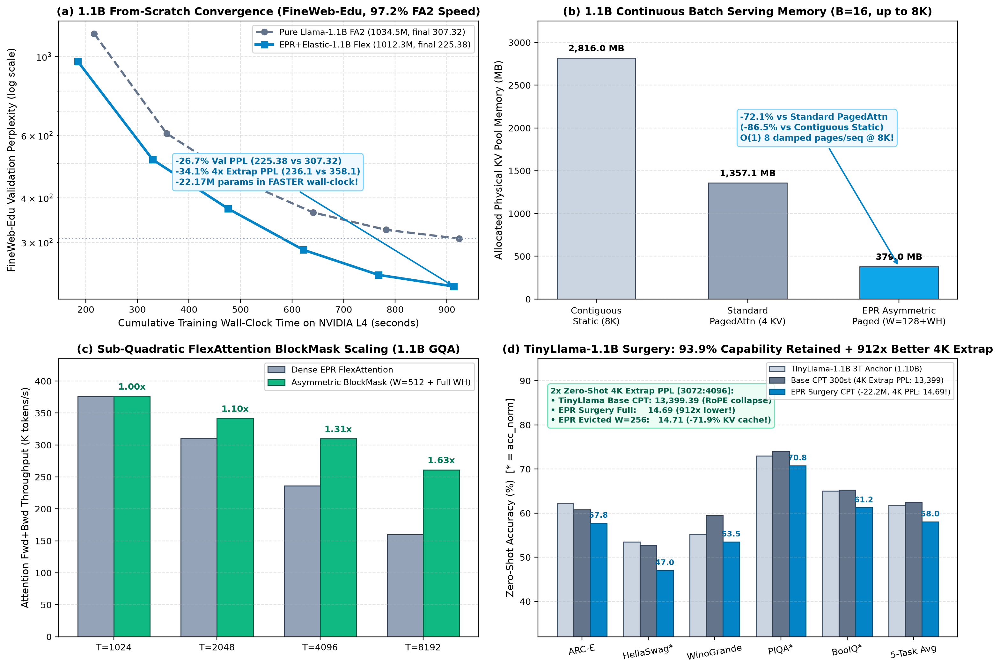

<div align="center">

# EPR Attention (Euclidean-RBF, Proper-Time & Resonance-Fiber)

**A Geometry-Folded, Parameter-Saving Long-Context Attention Architecture with Industrial Triton PagedAttention**

**English** | [简体中文](README_zh.md) · [📐 Math & Exact Folding](docs/MATH.md) · [🗂️ Raw v3.0 (1.1B) Telemetry](benchmarks/raw_v3/README.md) · [🗂️ Raw v2.0 (6M) Telemetry](benchmarks/raw_v2/README.md) · [🏷️ v2.0 Release](https://github.com/Dracen-W/epr-attention/releases/tag/2.0) · [📊 v1.0 Legacy Archive](docs/BENCHMARKS.md) · [🏷️ v1.0 Release](https://github.com/Dracen-W/epr-attention/releases/tag/1.0)

[](LICENSE)
[](NOTICE)
[](audit_all.py)
[](benchmarks/raw_v3/README.md)

</div>

---

## Why EPR Attention? — Five Core Selling Points

1. **Higher Sample Efficiency with Strictly Fewer Parameters (Apples-to-Apples From-Scratch)**: Under identical architecture depth/width, data stream (`FineWeb-Edu`), and token budget at **`1.1B` scale**, EPR uses **`-22.17M` fewer parameters** yet achieves **`-26.7%` lower validation perplexity (`225.38` vs. `307.32`)**, overtaking `Pure Llama-1.1B`'s 300-step final score **before Step 200 (`-33.3%` fewer tokens & `-32.7%` less wall-clock time)** while running at **`97.2%` of native FlashAttention-2 step speed** (`6.0M` 3-seed suite likewise beats `Llama 2` by **`-20.7%`** and ICLR'25 `FoX` by **`-15.1%`**).
2. **Hardware-Aligned `d_r + d_g + 2 == D` Algebraic Folding & Closed-Form Parameter Savings**: Packs fiber resonance, shared heteroscedastic Euclidean-RBF capture basins, and a zero-value vacuum floor into one power-of-2 head dimension (`D = 32, 64, 128`, **zero `V` padding**), saving matrix weights by an exact closed-form law (*empirically verified from `1.3M` to `1.1B`; holds strictly in theory beyond `1.1B`*).
3. **Industrial `@triton.jit` PagedAttention Cutting Physical KV Memory by `-72.1%`**: Intra-layer damped heads recycle expired physical KV pages in $O(1)$ while NoPE Wormhole heads retain full global context—shrinking `1.1B GQA` continuous-batching KV pools (`B=16`, up to `8K`) from `1,357.1 MB` (Standard PagedAttention) down to **`379.0 MB`** (`-86.5%` vs. static `2,816.0 MB`) with zero-read online-Softmax vacuum folding (`0.00e+00` `bf16` kernel error).
4. **Sub-Quadratic `1.63×` Long-Context Speedup & Collapse-Free Extrapolation**: Head-asymmetric `FlexAttention` `BlockMask` skips $O(T^2)$ distant tiles on damped heads for a **`1.63×` Fwd+Bwd speedup at `8K`**, while bounding attention dispersion for smooth `2×–4×` zero-shot length extrapolation (`-34.1%` `4×` extrap PPL from scratch; **`912×` lower `2×` extrap PPL** after surgical conversion, with **`+0.02` PPL** when evicting **`71.9%` KV** at `W=256`).
5. **47-Minute Drop-In Checkpoint Surgery for Existing Open LLMs**: Without retraining `3T` tokens from scratch, [`upgrade_hf_llama_to_epr()`](hf_epr.py) converts pretrained HuggingFace `Llama` weights in place (`-22.17M` params removed) and—with just **`9.83M` healing tokens (`0.00033%` of `3T`, 47 min on one L4, zero distillation)**—already recovers **`93.9%`** of `3T` 5-benchmark zero-shot accuracy while curing RoPE's `13,399` extrapolation cliff down to **`14.69`**.

---

## Headline Benchmark Summary (`v3.0` Industrial & `1.1B` Suite, NVIDIA L4 `bfloat16`)



| Evaluation Pillar | Baseline (`FA2` / `PagedAttn` / `TinyLlama-1.1B`) | **EPR + Mass-Elastic RBF (`v3.0`)** | Verified Gain / Takeaway |
| :--- | :---: | :---: | :--- |
| **`1.1B` From-Scratch `FineWeb-Edu`** *(Fair Equal-Token Test, `22L, 32Q/4KV`)* | `Val PPL = 307.32` (`1,034.5M`, `924.3s`) | **`Val PPL = 225.38`** (`1,012.3M`, **`913.7s`**) | **`-26.7%` lower PPL** (`-0.310` NLL), **`-22.17M` fewer params**, **beats 300-step `FA2` before Step 200 (`-33.3%` tokens, `-32.7%` wall-clock)** at **`97.2%` `FA2` step speed** |
| **`1.1B` From-Scratch `4×` Extrap** *(`T_train=1024 → [2048:4096]`)* | `PPL = 358.08` | **`PPL = 236.07`** | **`-34.1%` lower `4×` zero-shot extrapolation PPL** |
| **`1.1B` Continuous-Batch KV Memory** *(`B=16`, lens up to `8192`)* | `1,357.1 MB` *(Std Paged)* / `2,816.0 MB` *(Static)* | **`379.0 MB`** *(`@triton.jit`, `W=128+1 WH`)* | **`-72.1%` vs. Standard PagedAttention** (`-86.5%` vs. Static) via $O(1)$ damped-page recycling (`0.00e+00` `bf16` kernel error) |
| **`1.1B` `8K` Sparse `BlockMask` Speed** *(`T=8192`, Fwd+Bwd)* | `159,765 tok/s` *(Dense EPR Flex)* | **`261,076 tok/s`** *(`W=512 + Full WH`)* | **`1.63×` sub-quadratic Fwd+Bwd speedup** at `8K` by skipping $O(T^2)$ tiles on `24/32` damped heads |
| **`6.0M` 3-Seed Statistical Suite** *(Fair Equal-Token Test, `seeds=1337,2026,42`)* | `Llama 2: 47.68` / `FoX (ICLR'25): 44.52` | **`37.80 ± 0.07`** *(`4×` Extrap `34.21`)* | **`-20.7%` vs. Llama 2**, **`-15.1%` vs. `FoX`**, **`+6.1%` higher `@1536` Passkey recall**, negative OOD overconfidence shift (`-1.55%`) |
| **`TinyLlama-1.1B` Low-Cost Surgery** *(`-22.2M` cut + **only `0.00033%` of `3T` tokens**)* | `4K Extrap: 13,399` · `5-Task: 61.80%` *(3T)* | **`4K Extrap: 14.69` (`14.71 @W=256`)** · **`58.05%`** | **`912×` lower `4K` extrap PPL** (`+0.02` with **`71.9%` KV evicted**) + **`93.9%` of `3T` capability already healed in 47 min (`9.83M` vs. `3T` tokens!)** |

---

## Closed-Form Parameter-Saving Law (Empirically Verified `1.3M → 1.1B`)

Because Query reuses the symmetric base coordinate $z \in \mathbb{R}^{d_g}$ (`H · d_g` projection columns eliminated) and the `+2` algebraic folding slots (`-0.5‖z‖²` and `1`) require zero learned projection weights (`2(H + H_kv)` columns eliminated), **EPR Attention strictly reduces matrix parameter count relative to standard MHA/GQA while keeping `head_dim = D` power-of-2 aligned (`d_r + d_g + 2 == D`, zero `V` padding)**:

$$\Delta P_{\text{matrix}} = - L \cdot C \cdot \big[\, H(d_g + 1) + H_{\text{kv}} + H_{\text{wh}} \,\big]$$

where $L$ is layer count, $C$ is model hidden dimension, $H$ is query head count, $H_{\text{kv}}$ is KV head count, $H_{\text{wh}}$ is Wormhole query head count, and $d_g$ is the shared Euclidean base dimension (`d_g = 6` at `D=32`; `d_g = 14` at `D=64`; `d_g = 30` at `D=128`).

> [!IMPORTANT]
> **Verification Scope (`Million`-Scale to `1.1B` Empirical vs. Larger-Scale Theoretical):**
> - **Empirically Verified (`1.3M` → `1.1B`)**: This closed-form law has been **experimentally tested and verified to the exact integer** across discrete model tiers from Million-scale up to `1.1B`:
>   - **`1.3M` MHA (`4L, C=128, 4H, d_g=6`)**: Formula = **`-16,896`** matrix params (`-16,836` net with 1D scalars) — **exact match**.
>   - **`6.0M` MHA (`6L, C=256, 4H, d_g=14`)**: Formula = **`-99,840`** matrix params (`5,769,050` vs `5,868,800` total) — **exact match**.
>   - **`28M` MHA (`6L, C=512, 8H, d_g=14`)**: Formula = **`-396,288`** matrix params (`28.45M` vs `28.84M`) — **exact match**.
>   - **`1.1B` GQA (`22L, C=2048, 32Q/4KV, H_wh=8, d_g=14`)**: Formula = $-22 \times 2048 \times [32(15) + 4 + 8] =$ **`-22,167,552`** matrix params (`1,012,252,672` vs `1,034,420,224` decayed weights in Track A; `-22,166,760` net total delta after `+792` 1D scalars in Track B `TinyLlama-1.1B` surgery) — **exact match to the single parameter**.
> - **Theoretical Extrapolation (`> 1.1B`)**: Models larger than `1.1B` (e.g., `7B` or `70B`, where 8:1 GQA projects `-1.31B` / `-21.7%` `Q/K` router savings) have **not yet been empirically trained or benchmarked** due to single-GPU compute constraints; however, because $\Delta P_{\text{matrix}}$ is a pure linear-algebraic identity of the projection tensor shapes, **the parameter-saving formula itself holds strictly in theory at arbitrary scale**.

> **Attribution & Scope:** Built on Andrej Karpathy's [`llama2.c`](https://github.com/karpathy/llama2.c) (MIT License) and the **Meta Llama 2** architecture (Touvron et al., 2023). Milestone archives: [`v2.0` Release](https://github.com/Dracen-W/epr-attention/releases/tag/2.0) · [`v1.0` Release](https://github.com/Dracen-W/epr-attention/releases/tag/1.0). Note that `export.py`, `run.c`, and `runq.c` are inherited from `llama2.c` and do not yet support EPR Attention (PyTorch / Triton / HuggingFace supported).
>
> **Physics Inspiration Disclaimer:** Terms such as *proper time*, *vacuum floor*, *wormhole head*, and *mass-elastic capture basin* reflect physical and neurochemical intuition (**inspired by**, not derived from, general relativity or quantum gravity). Mathematically, all components are differentiable PyTorch/Triton primitives folded into one hardware-aligned $D$-dimensional attention kernel (see [`docs/MATH.md`](docs/MATH.md)).

---

## Core Architecture Overview

**EPR Attention** ([`epr_attention.py`](epr_attention.py), [`epr_paged_attention.py`](epr_paged_attention.py), [`hf_epr.py`](hf_epr.py)) folds three geometric primitives—plus **Mass-Elastic Heteroscedastic RBF**—into a single `d_r + d_g + 2 == head_dim` inner-product kernel:

1. **Un-Shifted 2-Slot Algebraic Folding (`d_r + d_g + 2 == D`)**: Combines directional fiber resonance ($q_{\text{res},i} \cdot k_{\text{res},j} / \sqrt{d_r}$) with a symmetric head-shared Euclidean-RBF capture potential ($-\frac{\gamma_{h,j}}{2}\|z_i - z_j\|_2^2$) inside exact power-of-2 head dimensions (`D=32 → 24+6+2`; `D=64 → 48+14+2`; `D=128 → 96+30+2`).
2. **Learnable Zero-Value Vacuum Floor ($e^{v_{0,h}}, V_{\text{vac}} = \mathbf{0}_D$)**: Allows attention heads to stay cleanly silent on irrelevant or unanswerable context without polluting `<BOS>` token value norms—and folds into `@triton.jit` PagedAttention online-Softmax registers (`m_i = v0, l_i = 1.0, acc = 0`) with **zero memory reads**.
3. **Intra-Layer Dual-Regime Head Topology**: Within *every* layer, $H - H_{\text{wh}}$ **Damped Heads** apply RoPE + content-driven proper-time decay ($\tau_i - \tau_j \ge 0$) for stable length extrapolation, $O(T \cdot W)$ `BlockMask` tile-skipping, and $O(1)$ physical page recycling; $H_{\text{wh}}$ **Wormhole Head(s)** apply **NoPE + zero decay ($\delta\tau \equiv 0$) + high vacuum threshold** for global retrieval.
4. **Mass-Elastic Heteroscedastic RBF (`--use_elastic_rbf=True`, Default Recommended)**: Key potential $u_{h,j}$ dynamically dilates capture variance $\gamma_{h,j} = \gamma_{0,h} / (1 + \alpha_h \sigma(u_{h,j}))$ inside the **exact same 2-slot `D`-dim kernel** (`97.2%` of `FlashAttention-2` speed at `1.1B`). *(Optional `--use_resonant_tunneling=True` adds pairwise decay gating for specialized small-scale recall.)*

---

## 1. `v3.0` Billion-Scale (`1.1B`) & Industrial Systems Benchmarks (Raw Data in [`benchmarks/raw_v3/`](benchmarks/raw_v3/README.md))

### 1.1 Track A: `1.1B` From-Scratch Pretraining on `FineWeb-Edu` (`22L, dim=2048, 32Q/4KV`, NVIDIA L4)
*Identical streamed `FineWeb-Edu` data order, optimizer (`fused AdamW`, cosine LR `3e-4 → 3e-5`), and token budget (`300 steps × 16,384 tokens/step = 4.92M tokens`, `T_train = 1024`, `torch.compile`).*

| Model (`1.1B` From-Scratch) | Decayed Matrix Params | Step Time / Throughput | Peak VRAM | Val PPL `@100` | Val PPL `@200` | Final Val PPL `@300` (Wall) | `4K` Extrap `[0:1K] / [1K:2K] / [2K:4K]` |
| :--- | :---: | :---: | :---: | :---: | :---: | :---: | :---: |
| **`pure_llama_1b` (`FA2` Baseline)** | `1,034,420,224` | `2808.6 ms` (`5,833 tok/s`) | `10.90 GiB` | `607.46` (`357s`) | `364.09` (`641s`) | `307.32` (`924.3s`) | `287.34 / 315.58 / 358.08` |
| **`epr_elastic_1b` (Ours)** | **`1,012,252,672` (`-22.17M`)** | `2890.1 ms` (**`5,669 tok/s`, `97.2%` FA2**) | `11.03 GiB` | **`512.71`** (`330s`) | **`285.79` (`622s`)** | **`225.38` (`913.7s`, `-26.7%`)** | **`205.04 / 227.27 / 236.07` (`-34.1%`)** |

### 1.2 Track B: Pretrained `TinyLlama-1.1B-3T` Architectural Surgery, Downstream Capabilities & `4K` Extrapolation
*Using [`upgrade_hf_llama_to_epr()`](hf_epr.py) on `TinyLlama-1.1B-intermediate-step-1431k-3T` (`1.10B → 1.08B`, preserving 100% of `MLP / W_V / W_O` and the top `48/64` RoPE frequency pairs), followed by `300` continued-pretraining (CPT) steps at `T=2048` (`9.83M` `FineWeb-Edu` tokens = **`0.00033%`** of `3T` pretraining) vs. an identically CPT'd `base_1b_cpt` control (`400` validation samples/task):*

| Model Variant | Total Params | `ARC-Easy` (`acc`) | `HellaSwag` (`acc_norm`) | `WinoGrande` (`acc`) | `PIQA` (`acc_norm`) | `BoolQ` (`acc_norm`) | **5-Task Avg** | `2×` Extrap PPL `[2048:3072]` | `2×` Extrap PPL `[3072:4096]` |
| :--- | :---: | :---: | :---: | :---: | :---: | :---: | :---: | :---: | :---: |
| **`TinyLlama-1.1B` (`3T` Untouched Anchor)** | `1,100.05M` | `62.25%` | `53.50%` | `55.25%` | `73.00%` | `65.00%` | `61.80%` *(raw `56.95%`)* | `1,444.35` | `12,829.90` |
| **`base_1b_cpt` (`300`-step CPT Control)** | `1,100.05M` | `60.75%` | `52.75%` | `59.50%` | `74.00%` | `65.25%` | `62.45%` | `1,760.35` | `13,399.39` |
| **`epr_elastic_1b_cpt` (Surgery + `300`-step CPT)** | **`1,077.88M` (`-22.17M`)** | **`57.75%`** | **`47.00%`** | **`53.50%`** | **`70.75%`** | **`61.25%`** | **`58.05%` (`93.9%` of 3T!)** | **`12.26`** | **`14.69` (`912×` lower!)** |
| **`epr_elastic_1b_cpt` + Evicted `W=256` (`-71.9%` KV `@4K`)** | **`1,077.88M` (`-22.17M`)** | — | — | — | — | — | — | **`12.36`** | **`14.71` (`+0.02` vs Full!)** |

*(Scientific transparency note on surgical CPT budget: With only `9.83M` generic `FineWeb-Edu` tokens (`0.00033%` of `3T`) and zero synthetic passkey examples, surgical conversion already recovers **`93.9%` (`58.05% / 61.80%`)** of `3T` zero-shot commonsense/reading comprehension accuracy and completely eliminates RoPE's `13,399` extrapolation explosion down to `14.69`. However, newly initialized NoPE Wormhole heads (`v0_init = +1.8`) remain conservatively silent on exact 5-digit verbatim `Passkey` string copying (`0.0%` vs `100%/12.5%/0.0%` on `base_1b_cpt` `@1K/@2K/@3.5K`), indicating that exact Wormhole copy heads require either longer CPT or targeted long-context retrieval mixtures, whereas from-scratch training naturally activates them as verified in Section 2.)*

### 1.3 Industrial `@triton.jit` Asymmetric PagedAttention & Sub-Quadratic `BlockMask` (`1.1B GQA`)
- **Continuous-Batching Physical KV Pool (`B=16`, variable lengths `260..8192`, avg `3944`, `page_size=16`)**:
  - Contiguous Static (`max=8192`): `2,816.00 MB` · Standard PagedAttention (`4 KV`): `1,357.12 MB` · **EPR Asymmetric Paged (`W=128 + 1 WH`)**: **`379.02 MB`** (**`-72.1%` vs. Standard PagedAttention**, **`-86.5%` vs. Contiguous**).
  - Fused 22-layer `_epr_paged_decode_kernel` (`B=8`, constant `8` damped pages/seq): `1.381 ms` (`5,793 tok/s` `@1K`) · `2.497 ms` (`3,204 tok/s` `@2K`) · `4.823 ms` (`1,659 tok/s` `@4K`) · `9.462 ms` (`845 tok/s` `@8K`).
- **Sub-Quadratic `FlexAttention` `BlockMask` Fwd+Bwd Throughput (`W_damped=512`, `32Q/4KV`)**:
  - `T=1024`: `376.2K` vs `375.4K tok/s` (`1.00×`) · `T=2048`: `341.5K` vs `310.1K` (`1.10×`) · `T=4096`: `309.8K` vs `236.0K` (`1.31×`) · **`T=8192`: `261.1K` vs `159.8K tok/s` (`1.63×` speedup)**.

---

## 2. Controlled `v2.0` Multi-Seed & Ablation Suite (`6.0M`, Raw Data in [`benchmarks/raw_v2/`](benchmarks/raw_v2/README.md))


### 2.1 Three-Seed Statistical Summary (`seeds = 1337, 2026, 42`, `Mean ± Std`)
*Setup: `6.0M` WikiText-2 (`dim=256, 6L, 4H, T_train=512, 3000 steps = 49.15M tokens`). Un-diluted bucketed PPL over 384 sequences (`L=2048`); 200-trial Passkey Needle recall per seed.*

| Architecture (`Mean ± Sample Std`, 3 seeds) | Params | In-Domain `Val PPL@512` | Bucket `[256:512]` | `2×` Bucket `[512:1024]` | `4×` Bucket `[1024:2048]` | Needle `@512` | Needle `@1024` | Needle `@1536` |
| :--- | :---: | :---: | :---: | :---: | :---: | :---: | :---: | :---: |
| **Pure Llama 2 (RoPE)** | `5.87M` | `47.68 ± 0.51` | `46.44 ± 0.66` | `97.59 ± 11.10` | `168.41 ± 18.90` | `25.28 ± 0.46%` | `13.89 ± 0.86%` | `13.86 ± 0.44%` |
| **FoX (Forgetting Transformer, ICLR'25)** | `5.87M` | `44.52 ± 0.25` | `43.57 ± 0.42` | `42.93 ± 0.36` | `42.22 ± 0.33` | `26.14 ± 0.21%` | `26.28 ± 0.46%` | `25.82 ± 0.23%` |
| **EPR v2.0 Distilled (`bilat=F, nest=F`)** | **`5.77M`** | **`37.80 ± 0.07`** | **`35.58 ± 0.11`** | **`34.80 ± 0.14`** | **`34.21 ± 0.26`** | **`34.95 ± 0.96%`** | **`33.07 ± 0.59%`** | **`31.89 ± 0.39%`** |
| **EPR v2.0 + Mass-Elastic RBF** | **`5.77M`** | `37.95 ± 0.23` | `35.71 ± 0.32` | `34.96 ± 0.27` | `34.39 ± 0.35` | `34.65 ± 0.20%` | `32.90 ± 0.17%` | **`31.88 ± 0.86%`** *(peak `32.58%`)* |

*(Additional `seed=1337` baselines: **Dynamic NTK** `[1024:2048] = 52.22`; **YaRN** `126.63`; **ALiBi** `42.60`, `Needle@1536 = 23.13%`. Full OOD calibration & `W=128` KV eviction tables are preserved in [`v2.0` Release](https://github.com/Dracen-W/epr-attention/releases/tag/2.0) and [`docs/figures/v2_6m_ood_and_kv_eviction.png`](docs/figures/v2_6m_ood_and_kv_eviction.png).)*

---

## 3. Convergent 2025–2026 Literature Positioning

- **Content-Driven Proper-Time Decay ($\tau_i - \tau_j$)**: Mathematically isomorphic to **FoX (Forgetting Transformer, ICLR 2025)** when $M = I$; EPR pairs $\tau$ with a shared Euclidean-RBF capture basin and an intra-layer NoPE Wormhole head (`-15.3%` lower `4×` PPL and `+6.1%` higher `@1536` recall than FoX).
- **Zero-Value Vacuum Floor ($e^{v_0}, V_{\text{vac}} = \mathbf{0}_D$)**: Related to **Softmax1** (Miller, 2023), **OpenAI `gpt-oss`** learnable sinks (2025), and **ICML 2026** *SinkProbe* analyses, while folding into Triton online-Softmax registers with zero extra memory reads.
- **Intra-Layer Single-Kernel Dual-Regime vs. Layer-Interleaved Hybrids**: Unlike **Llama 4 (`iRoPE`)**, **Gemma 3/4**, **DuoAttention (ICLR 2025)**, or **Qwen3.5 / Kimi Linear**, EPR unifies damped local heads and NoPE global heads **inside every layer within a single $D$-aligned kernel**, while cutting `~20%` of `Q/K` router parameters.

---

## 4. Quick Start

```bash
# 1. Run 9-pillar mathematical, causality, stateful/paged KV-cache, HF wrapper & CUDA/Triton audit
python3 audit_all.py

# 2. v3.0 Industrialization & 1.1B Suite (CUDA GPU: Triton PagedAttention, 8K Sparse BlockMask & 1.1B Benchmarks)
python3 bench_paged_and_sparse.py
python3 eval_1b_industrial.py

# 3. Controlled 6M research & ablation suite (WikiText-2)
python3 train.py config/train_wikitext2_colab_scale.py --out_dir=out-6m-epr-elastic --use_epr=True --use_elastic_rbf=True
python3 eval_extrapolation.py out-6m-epr-elastic --lengths=256,512,1024,2048
python3 eval_kv_eviction.py out-6m-epr-elastic
```

---

## 5. Origin, Literature Attribution & AI Collaboration Disclosure

- **Independent Conceptual Origin**: All core conceptual hypotheses in this project—evolving from neurochemical dissipation and spatial potential fields to bounded Euclidean capture basins, mass-elastic capture radii, content-driven proper-time damping, zero-value physical vacuum floors, and intra-layer zero-decay wormhole heads—were **conceived and reasoned independently from first principles by the author prior to reading or consulting the concurrent/prior papers cited in Section 3** (documented in a chronological ideation archive).
- **Post-Hoc Literature Credit**: All mathematical equivalences and convergent design relationships with prior and 2025–2026 concurrent literature (`Softmax1`, `FoX`, `DuoAttention`, `iRoPE / RNoPE / Gemma 4`, `gpt-oss`, `ICLR/ICML 2026` sink & scaling analyses) were identified during subsequent AI-assisted literature auditing and are explicitly cited in [`CITATION.bib`](CITATION.bib).
- **Transparent AI Collaboration**: The human author originated the conceptual architecture, steered every pruning/refinement hypothesis, and directed experimental validation; AI assistants (`Gemini` / `Antigravity`) formalized the exact `d_r + d_g + 2 == D` algebraic folding and closed-form parameter law, implemented the PyTorch/`FlexAttention`/`@triton.jit` PagedAttention & HuggingFace surgery codebase and 9-pillar audit suite, conducted literature cross-checks, and executed automated GPU benchmarks.
- **License**: MIT License (preserving Andrej Karpathy's original `llama2.c` copyright; see [`LICENSE`](LICENSE) and [`NOTICE`](NOTICE)).

```bibtex
@misc{dracenw2026epr,
  title        = {EPR Attention: A Geometry-Folded, Parameter-Saving Long-Context Attention Architecture},
  author       = {Dracen-W},
  year         = {2026},
  howpublished = {\url{https://github.com/Dracen-W/epr-attention}},
  note         = {Built on karpathy/llama2.c and the Meta Llama 2 architecture}
}
```
