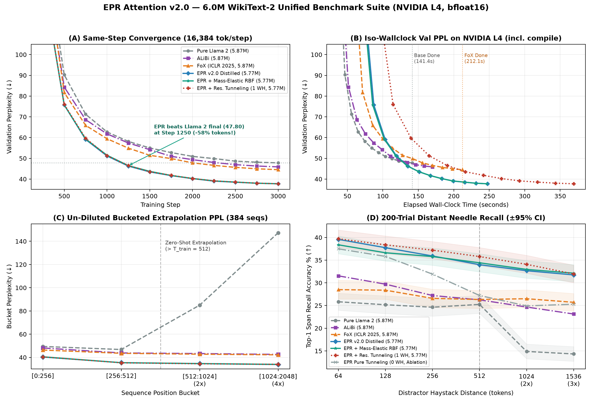
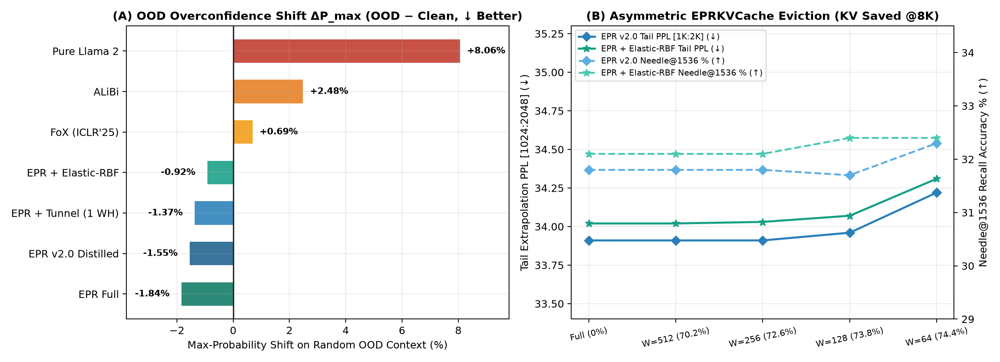

<div align="center">

# EPR Attention (Euclidean-RBF, Proper-Time & Resonance-Fiber)

**An Experimental Geometry-Folded Long-Context Attention Mechanism Built on `llama2.c`**

**English** | [简体中文](README_zh.md) · [📐 Math & Exact Folding](docs/MATH.md) · [🗂️ Raw v2.0 Telemetry](benchmarks/raw_v2/README.md) · [🏷️ v2.0 Release](https://github.com/Dracen-W/epr-attention/releases/tag/2.0) · [📊 v1.0 Legacy Archive](docs/BENCHMARKS.md) · [🏷️ v1.0 Release](https://github.com/Dracen-W/epr-attention/releases/tag/1.0)

[](LICENSE)
[](NOTICE)
[](audit_all.py)
[](epr_paged_attention.py)

</div>

> [!IMPORTANT]
> **Active Milestone Status (`v3.0-dev` on `main`):**
> - **[`v2.0` Milestone Snapshot](https://github.com/Dracen-W/epr-attention/releases/tag/2.0)** archives the completed unified `d_r + d_g + 2 == D` core, **Mass-Elastic Heteroscedastic RBF**, **Pairwise Resonant Tunneling**, 3-seed NVIDIA L4 statistical benchmarks, and OOD / abstention probes (raw logs in [`benchmarks/raw_v2/`](benchmarks/raw_v2/README.md); [`v1.0` snapshot here](https://github.com/Dracen-W/epr-attention/releases/tag/1.0)).
> - **`v3.0-dev` (Current `main` — In Progress)**: Industrialization & `1.1B`-scale evaluation phase. Custom `@triton.jit` **Asymmetric PagedAttention** ([`epr_paged_attention.py`](epr_paged_attention.py) with $O(1)$ damped-page recycling & zero-read online-Softmax vacuum folding), **Sub-Quadratic `FlexAttention` `BlockMask`** (`flex_damped_window`), and **HuggingFace `PreTrainedModel` + `1.1B` frequency-preserving surgery** ([`hf_epr.py`](hf_epr.py), [`bench_paged_and_sparse.py`](bench_paged_and_sparse.py), [`eval_1b_industrial.py`](eval_1b_industrial.py)) are implemented and pass all **9 local `fp64` audit pillars**; `1.1B` standard benchmark runs are currently queued for GPU execution.

> **Attribution & Scope:** Built on Andrej Karpathy's [`llama2.c`](https://github.com/karpathy/llama2.c) (MIT License) and the **Meta Llama 2** architecture (Touvron et al., 2023). Note that `export.py`, `run.c`, and `runq.c` are inherited from `llama2.c` and **do not yet support EPR Attention** (PyTorch only). See [`LICENSE`](LICENSE), [`NOTICE`](NOTICE), and [`CITATION.bib`](CITATION.bib).

> **Physics Inspiration Disclaimer:** Terms such as *proper time*, *vacuum floor*, *wormhole head*, and *mass-elastic capture basin* reflect physical and neurochemical intuition (**inspired by**, not derived from, general relativity or quantum gravity). Mathematically, all components are clean differentiable PyTorch primitives folded into one hardware-aligned $D$-dimensional attention kernel (see [`docs/MATH.md`](docs/MATH.md)).

---

## Overview & Exact Parameter-Saving Law

**EPR Attention (`v2.0`)** ([`epr_attention.py`](epr_attention.py)) unifies three essential geometric primitives—plus two optional extensions (**Mass-Elastic Heteroscedastic RBF** and **Pairwise Resonant Tunneling**)—into a single `d_r + d_g + 2 == head_dim` inner-product kernel with **zero $V$-channel padding**:

1. **Un-Shifted 2-Slot Algebraic Folding (`d_r + d_g + 2 == D`)**: Combines directional resonance ($q_{\text{res},i} \cdot k_{\text{res},j} / \sqrt{d_r}$) with a symmetric head-shared Euclidean-RBF capture potential ($-\frac{\gamma_{h,j}}{2}\|z_i - z_j\|_2^2$) inside exact power-of-2 head dimensions (`D=32 → 24+6+2`; `D=64 → 48+14+2`; `D=128 → 96+30+2`).
2. **Learnable Zero-Value Vacuum Floor ($e^{v_{0,h}}, V_{\text{vac}} = \mathbf{0}_D$)**: Allows attention heads to stay cleanly silent on irrelevant or unanswerable context without polluting `<BOS>` value norms, while enabling zero-cost abstention probing.
3. **Intra-Layer Dual-Regime Head Topology**: Within *every* layer, $H - H_{\text{wh}}$ **Damped Heads** apply RoPE + content-driven proper-time decay ($\tau_i - \tau_j \ge 0$) for stable extrapolation and $O(1)$ ring-buffer KV eviction; $H_{\text{wh}}$ **Wormhole Head(s)** apply **NoPE + zero decay ($\delta\tau \equiv 0$) + high vacuum threshold ($v_0 = +2.5$)** for distance-invariant retrieval.
4. **Optional Extensions**:
   - **Mass-Elastic Heteroscedastic RBF (`--use_elastic_rbf=True`)**: Key potential $u_{h,j}$ dynamically dilates capture variance $\gamma_{h,j} = \gamma_{0,h} / (1 + \alpha_h \sigma(u_{h,j}))$ inside the **exact same 2-slot `D`-dim kernel** (`+24` scalars at 6M, `0%` step overhead, `>91%` `FlexAttention` throughput).
   - **Pairwise Resonant Tunneling (`--use_resonant_tunneling=True`)**: Pairwise pre-decay affinity dynamically suppresses $\Delta\tau$ via $1 - \sigma(\beta_h(S_{i,j} - \theta_h))$, boosting mid/long-range recall at the cost of `~1.59×` slower SDPA steps (`~6.5×` slower `FlexAttention` backward).

### Closed-Form Parameter-Saving Law
Because Query reuses the symmetric base coordinate $z$ (`H · d_g` columns saved) and the `+2` algebraic slots require zero projection weights (`2(H + H_kv)` columns saved), EPR saves **strictly positive matrix parameters at every scale**:

$$\Delta P_{\text{matrix}} = - L \cdot C \cdot \big[\, H(d_g + 1) + H_{\text{kv}} + H_{\text{wh}} \,\big]$$

- **1.3M MHA (`4L, C=128, 4H, d_g=6`)**: `-16,896` matrix weights (`-16,852` net).
- **6.0M MHA (`6L, C=256, 4H, d_g=14`)**: **`-99,840` matrix weights (`-99,774` net, `5.77M` vs `5.87M`)**.
- **28M MHA (`6L, C=512, 8H, d_g=14`)**: `-396,288` matrix weights (`28.45M` vs `28.84M`).
- **1.1B GQA (`22L, C=2048, 32Q/4KV, d_g=14`)**: **`-22.17M` matrix weights** (`-21.7%` of `Q/K` router weights at 70B 8:1 GQA).

---

## 1. Unified `v2.0` Benchmarks (NVIDIA L4, `bfloat16`, Raw Data in [`benchmarks/raw_v2/`](benchmarks/raw_v2/))



### 1.1 Three-Seed Statistical Summary (`seeds = 1337, 2026, 42`, `Mean ± Std`)
*Setup: `6.0M` WikiText-2 (`dim=256, 6L, 4H, T_train=512, 3000 steps = 49.15M tokens`). Un-diluted bucketed PPL over 384 sequences (`L=2048`); 200-trial dummy-aligned Passkey Needle recall per seed.*

| Architecture (`Mean ± Sample Std`, 3 seeds) | Params | In-Domain `Val PPL@512` | Bucket `[0:256]` | Bucket `[256:512]` | `2×` Bucket `[512:1024]` | `4×` Bucket `[1024:2048]` | Needle `@512` | Needle `@1024` | Needle `@1536` |
| :--- | :---: | :---: | :---: | :---: | :---: | :---: | :---: | :---: | :---: |
| **Pure Llama 2 (RoPE)** | `5.87M` | `47.68 ± 0.51` | `49.38 ± 0.41` | `46.44 ± 0.66` | `97.59 ± 11.10` | `168.41 ± 18.90` | `25.28 ± 0.46%` | `13.89 ± 0.86%` | `13.86 ± 0.44%` |
| **FoX (Forgetting Transformer, ICLR'25)** | `5.87M` | `44.52 ± 0.25` | `46.42 ± 0.30` | `43.57 ± 0.42` | `42.93 ± 0.36` | `42.22 ± 0.33` | `26.14 ± 0.21%` | `26.28 ± 0.46%` | `25.82 ± 0.23%` |
| **EPR v2.0 Distilled (`bilat=F, nest=F`)** | **`5.77M`** | **`37.80 ± 0.07`** | **`40.46 ± 0.09`** | **`35.58 ± 0.11`** | **`34.80 ± 0.14`** | **`34.21 ± 0.26`** | **`34.95 ± 0.96%`** | **`33.07 ± 0.59%`** | **`31.89 ± 0.39%`** |
| **EPR v2.0 + Mass-Elastic RBF** | **`5.77M`** | `37.95 ± 0.23` | `40.60 ± 0.10` | `35.71 ± 0.32` | `34.96 ± 0.27` | `34.39 ± 0.35` | `34.65 ± 0.20%` | `32.90 ± 0.17%` | **`31.88 ± 0.86%`** *(peak `32.58%`)* |

*(Additional `seed=1337` RoPE scaling baselines on Pure Llama 2: **Dynamic NTK** `[1024:2048] = 52.22`; **YaRN** `[1024:2048] = 126.63`; **ALiBi** `[1024:2048] = 42.60`, `Needle@1536 = 23.13%`.)*

---

### 1.2 Same-Step (Sample Efficiency) & Iso-Wallclock Comparison (`seed=1337`, NVIDIA L4)
Even on a small 6M model—where kernel launch overhead makes EPR `1.71×` slower per step than FlashAttention-2 (`61.2 ms` vs `35.7 ms`) and `torch.compile` warmup takes `~54s` vs `~28s`—EPR overtakes both Pure Llama 2 and ICLR'25 `FoX` in **both token count and raw wall-clock seconds**:

| Milestone (`16,384 tok/step`) | Pure Llama 2 (`35.7 ms`) | ALiBi (`51.7 ms`) | FoX ICLR'25 (`63.4 ms`) | **EPR + Mass-Elastic RBF (`61.6 ms`)** | **EPR + Res. Tunneling (`97.7 ms`)** | Key Takeaway |
| :--- | :---: | :---: | :---: | :---: | :---: | :--- |
| **Step 750 (`12.3M` tok)** | `71.25` (`55.9s`) | `68.63` (`63.6s`) | `65.89` (`85.7s`) | **`59.32`** (`101.8s`) | `59.66` (`139.8s`) | `-16.7%` lower PPL at same token budget |
| **Step 1,250 (`20.5M` tok)** | `58.13` (`74.8s`) | `57.38` (`87.3s`) | `54.89` (`113.7s`) | **`46.46` (`133.8s`)** | `46.51` (`190.7s`) | **Beats Llama 2's 3000-step final (`47.80`, `141.4s`) in less wall-clock time & `-58.3%` fewer tokens!** |
| **Step 1,500 (`24.6M` tok)** | `54.99` (`84.3s`) | `54.17` (`99.1s`) | `51.45` (`127.7s`) | **`43.71` (`149.8s`)** | **`43.53` (`216.2s`)** | **Beats FoX's 3000-step final (`44.52`, `212.1s`) in `-29.4%` less wall-clock time & `-50.0%` fewer tokens!** |
| **Step 3,000 (`49.2M` tok)** | `47.80` (`141.4s`) | `45.87` (`170.0s`) | `44.52` (`212.1s`) | **`37.73` (`246.5s`)** | **`37.72` (`369.0s`)** | **`-21.1%` lower PPL than Llama 2; `-15.3%` lower than FoX** |

### 1.3 `FlexAttention` Hardware Throughput (`dropout=0.0`, `T=1024`, NVIDIA L4)
| Scale & Configuration | Pure Llama 2 (FA2) | EPR v2.0 Distilled (Flex) | EPR + Mass-Elastic RBF (Flex) | EPR + Res. Tunneling (Flex) |
| :--- | :---: | :---: | :---: | :---: |
| **6M (`dim=256, 6L, 4H, B=8`)** | `333,861 tok/s` (`839 MB`) | `197,855 tok/s` (`930 MB`) | **`185,246 tok/s` (`93.6%` of v2.0)** | `27,848 tok/s` *(pairwise bwd)* |
| **28M (`dim=512, 6L, 8H, B=4`)** | `119,035 tok/s` (`1163 MB`) | **`98,070 tok/s` (`82.4%` of FA2)** | **`88,806 tok/s` (`90.6%` of v2.0)** | `15,059 tok/s` |
| **1.1B GQA (`dim=2048, 22L, 32Q/4KV`)** | `3,504 tok/s` (`10.51 GB`) | **`3,399 tok/s` (`97.0%` of FA2, `10.32 GB`)** | — | — |

---

## 2. Architecture Showdown, OOD Calibration & Stateful `EPRKVCache` Eviction



### 2.1 Eight-Variant Showdown (`seed=1337`: Recall, Anti-Prior Binding & OOD Hallucination Probe)
| Variant (`seed=1337`) | `[256:512]` | `[1024:2048]` | Needle `@512 / @1024 / @1536` | Std / Counterfactual 2-Key `@512` | OOD `ΔP_max` (`OOD − Clean`, ↓) | Zero-Cost Abstention `AUROC` |
| :--- | :---: | :---: | :---: | :---: | :---: | :---: |
| **Pure Llama 2** | `46.81` | `147.31` | `25.3% / 14.9% / 14.3%` | `83.0% / 17.5%` | `+8.06%` *(overconfident)* | — |
| **ALiBi** | `43.86` | `42.60` | `26.3% / 24.7% / 23.1%` | `79.0% / 22.0%` | `+2.48%` | — |
| **FoX (ICLR 2025)** | `43.55` | `42.25` | `26.3% / 26.5% / 25.7%` | `81.0% / 19.0%` | `+0.69%` | — |
| **EPR v2.0 Distilled** | `35.47` | **`33.91`** | `34.0% / 32.7% / 31.8%` | `84.5% / 19.5%` | **`-1.55%`** | **`0.5918`** (`+1.93%` vac) |
| **EPR + Mass-Elastic RBF (Recommended)** | `35.46` | `34.02` | `34.4% / 33.0% /` **`32.1%`** | `84.5% /` **`21.5%`** | `-0.92%` | `0.5911` (`+1.86%` vac) |
| **EPR + Resonant Tunneling (1 WH)** | **`35.37`** | `34.03` | **`35.8% / 34.1%`** `/ 32.0%` | `83.5% / 21.0%` | `-1.37%` | `0.5896` (`+1.75%` vac) |
| **EPR + Pure Tunneling (0 WH, Ablation)** | `36.22` | `34.77` | `27.2% / 24.9% / 25.3%` | `83.5% / 17.5%` | **`-3.21%`** | `0.5010` *(chance — proves WH essential!)* |
| **EPR Full (Elastic + Tunnel + 1 WH)** | `35.47` | `34.29` | `34.8% / 34.0% /` **`32.2%`** | **`85.5%`** `/ 18.0%` | `-1.84%` | `0.5868` (`+1.70%` vac) |

### 2.2 Stateful `EPRKVCache` Eviction Tradeoff & Decode Speed (`eval_kv_eviction.py`)
Evicting distant KV strictly on damped heads (`0..H-2`) into a fixed ring buffer `W` while keeping full context on the Wormhole head (`H-1`):

| Damped Window `W` | KV Saved `@2K` | KV Saved `@8K` | EPR v2.0 Tail PPL / Needle `@1536` | EPR + Elastic-RBF Tail PPL / Needle `@1536` | Cached Decode `tok/s` |
| :--- | :---: | :---: | :---: | :---: | :---: |
| `Full (∞)` | `0.0%` | `0.0%` | `33.91` / `31.8±1.9% (+0.50)` | `34.02` / `32.1±1.9% (+0.49)` | `83.9` / `81.1 tok/s` |
| `W = 256` | `65.5%` | `72.6%` | **`33.91` (`+0.00`)** / **`31.8±1.9%`** | **`34.03` (`+0.01`)** / **`32.1±1.9%`** | `68.4` / `67.9 tok/s` |
| **`W = 128`** | **`70.2%`** | **`73.8%`** | **`33.96` (`+0.05`)** / **`31.7±2.0%`** | **`34.07` (`+0.05`)** / **`32.4±1.9%`** | `70.4` / `68.6 tok/s` |
| `W = 64` | `72.6%` | `74.4%` | `34.22` (`+0.31`) / `32.3±1.9%` | `34.31` (`+0.29`) / `32.4±1.9%` | `70.0` / `68.7 tok/s` |

---

## 3. Convergent 2025–2026 Literature & Verification Status

During post-hoc literature auditing (through late 2026), several mathematical parallels and clear differentiators with concurrent/prior works were identified:
- **Content-Driven Proper-Time Decay ($\tau_i - \tau_j$)**: Mathematically isomorphic to **FoX (Forgetting Transformer, ICLR 2025)** when the legacy cascade is removed (`M = I`). Unlike pure forget-gate dot-product attention, EPR pairs $\tau$ with a shared Euclidean-RBF capture basin and an intra-layer NoPE Wormhole head (`-15.3%` lower 4× PPL and `+6.1%` higher `@1536` recall than FoX).
- **Zero-Value Vacuum Floor ($e^{v_0}, V_{\text{vac}} = \mathbf{0}_D$)**: Related to **Softmax1** (Miller, 2023), **OpenAI `gpt-oss`** learnable sinks (2025), and **ICML 2026** analyses of Attention Sinks as native intra-layer MoE routers and hallucination signals (*SinkProbe*). Setting $V_{\text{vac}} = \mathbf{0}_D$ with a high Wormhole threshold ($v_0 = +2.5$) avoids `<BOS>` super-neuron value pollution while yielding an intrinsic unanswerable-context signal.
- **Intra-Layer Dual-Regime Topology vs. Layer-Interleaved Hybrids**: Unlike **Llama 4 (`iRoPE`)**, **Gemma 3/4 (`p-RoPE` / local-global layers)**, **RNoPE/SWAN**, **DuoAttention (ICLR 2025)**, or **Qwen3.5 / Kimi Linear** (which either interleave separate local/global layers or require heterogeneous linear-RNN + FlashAttention kernels), EPR unifies damped local heads and NoPE global retrieval heads **inside every layer within a single $D$-aligned kernel**, avoiding `Critical Attention Scaling` dispersion collapse (Chen et al., ICLR 2026) without inference temperature hacks.
- **Folded Heteroscedastic Euclidean-RBF**: Related to L2/Gaussian attention (`Fast Gauss Sums via Flash Attention`, 2026), extended here via key-elastic inverse variance $\gamma_{h,j}$ folded into `d_r + d_g + 2 == D` with net parameter savings.

**Verified vs. Active `v3.0` Industrialization Roadmap:**
- ✅ **Verified (`v2.0` + `v3.0` Kernel Math)**: 9-pillar `fp64` + CUDA `bf16` zero-leakage audit (`0.00e+00`), `EPRPagedKVCache` $O(1)$ damped-page recycling (`2.78e-16` parity with dense `EPRKVCache`), 3-seed statistical superiority (`seeds = 1337, 2026, 42`), same-step & iso-wallclock advantage, `W=128` zero-drop KV eviction, OOD calibration & zero-cost abstention probe, 1.1B GQA throughput.
- 🚧 **In Progress (`v3.0` GPU Execution Queue)**: Executing [`bench_paged_and_sparse.py`](bench_paged_and_sparse.py) (1.1B Triton PagedAttention continuous-batching throughput & `8K` sub-quadratic `BlockMask` speedup) and [`eval_1b_industrial.py`](eval_1b_industrial.py) (`1.1B` from-scratch FineWeb-Edu convergence + `TinyLlama-1.1B` surgery on `ARC-Easy / HellaSwag / WinoGrande / PIQA / 4K Passkey NIAH`).

---

## 4. Quick Start

```bash
# 1. Run 9-pillar mathematical, causality, stateful/paged KV-cache, HF wrapper & CUDA audit
python3 audit_all.py

# 2. Train 6M EPR + Mass-Elastic RBF (recommended balanced flagship) vs Pure Llama 2
python3 train.py config/train_wikitext2_colab_scale.py --out_dir=out-6m-base --use_epr=False
python3 train.py config/train_wikitext2_colab_scale.py --out_dir=out-6m-epr-elastic --use_epr=True --use_elastic_rbf=True

# 3. Unified 6M evaluation suite (bucketed PPL, 200-trial needle, counterfactual binding, KV eviction & OOD probe)
python3 eval_extrapolation.py out-6m-base out-6m-epr-elastic --lengths=256,512,1024,2048
python3 eval_needle.py out-6m-base out-6m-epr-elastic --distances=64,128,256,512,1024,1536
python3 eval_associative_recall.py out-6m-base out-6m-epr-elastic
python3 eval_kv_eviction.py out-6m-epr-elastic
python3 eval_ood_hallucination.py out-6m-base out-6m-epr-elastic

# 4. v3.0 Industrialization Suite (CUDA GPU: Triton PagedAttention, 8K Sparse BlockMask & 1.1B Benchmarks)
python3 bench_paged_and_sparse.py
python3 eval_1b_industrial.py
```

---

## 5. Origin, Literature Attribution & AI Collaboration Disclosure

- **Independent Conceptual Origin**: All core conceptual hypotheses in this project—evolving from neurochemical dissipation and spatial potential fields to bounded Euclidean capture basins, mass-elastic capture radii, content-driven proper-time damping, zero-value physical vacuum floors, and intra-layer zero-decay wormhole heads—were **conceived and reasoned independently from first principles by the author prior to reading or consulting the concurrent/prior papers cited in Section 3** (documented in a complete chronological ideation archive).
- **Post-Hoc Literature Credit**: All mathematical equivalences and convergent design relationships with prior and 2025–2026 concurrent literature (`Softmax1`, `FoX`, `DuoAttention`, `iRoPE / RNoPE / Gemma 4`, `gpt-oss`, `ICLR/ICML 2026` sink & scaling analyses) were identified during subsequent AI-assisted literature auditing and are explicitly cited in [`CITATION.bib`](CITATION.bib).
- **Transparent AI Collaboration**: The human author originated the conceptual architecture, steered every pruning/refinement hypothesis, and directed experimental validation; AI assistants (`Gemini` / `Antigravity`) formalized the exact `d_r + d_g + 2 == D` algebraic folding, implemented the PyTorch/`FlexAttention` codebase and 8-pillar audit suite, conducted literature cross-checks, and executed automated GPU benchmarks.
- **License**: MIT License (preserving Andrej Karpathy's original `llama2.c` copyright; see [`LICENSE`](LICENSE) and [`NOTICE`](NOTICE)).

```bibtex
@misc{dracenw2026epr,
  title        = {EPR Attention: An Experimental Geometry-Folded Long-Context Attention Mechanism Built on llama2.c},
  author       = {Dracen-W},
  year         = {2026},
  howpublished = {\url{https://github.com/Dracen-W/epr-attention}},
  note         = {Built on karpathy/llama2.c and the Meta Llama 2 architecture}
}
```
