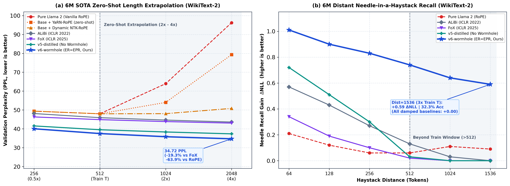
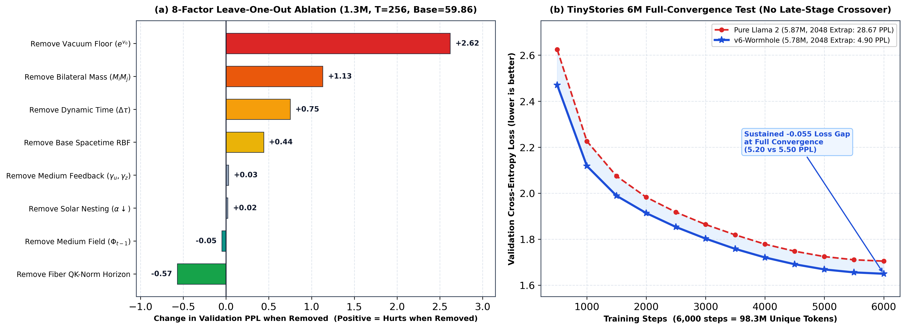

<div align="center">

# Unified Fiber-Gravity & ER=EPR Wormhole Attention (v6)

**Physics-Grounded Long-Context Attention on a Clean Llama 2 Backbone**

**English** | [简体中文](README_zh.md)

[](LICENSE)
[](NOTICE)
[](audit_all.py)

</div>

> **Attribution:** Built with the **Meta Llama 2** architecture (Touvron et al., 2023) on top of Andrej Karpathy's [`llama2.c`](https://github.com/karpathy/llama2.c) (MIT License). See [`LICENSE`](LICENSE), [`NOTICE`](NOTICE), and [`CITATION.bib`](CITATION.bib) for full license and citation terms.

**Unified Fiber-Gravity & ER=EPR Wormhole Attention (`v6-wormhole`)** replaces standard dot-product attention with a hardware-aligned, physically grounded interaction kernel that resolves the classic long-context dilemma: **damped attention extrapolates cleanly but forgets distant details, whereas undamped attention recalls distant needles but explodes beyond training length.**

Using **strictly fewer parameters (`-1.6%`)** than Pure Llama 2 and **verified zero future leakage (`0.00e+00` in `float64`)**, `v6-wormhole` simultaneously achieves:
- **-19.3% lower 4× extrapolation PPL** than **FoX (ICLR 2025)** (`34.72` vs `43.05`) and **-63.9%** vs Pure Llama 2 (`96.23`) on WikiText-2 (`6M, Train T=512 -> Eval 2048`).
- **Full 3× Distant Needle-in-a-Haystack Recall (`Dist=1536`)**: **`32.3%` Top-1 Acc (`+0.59 ΔNLL`)** while ALiBi, FoX, and damped-only ablations decay to **`+0.00 ΔNLL`**.
- **Sustained Full-Convergence Win on TinyStories (`6,000 steps / 98.3M tokens`)**: `5.20` vs `5.50` in-domain PPL and **`4.90` vs `28.67` (`-82.9%`)** at 4× extrapolation (`T=2048`).

---

## 1. Architecture Overview


### How It Works (Single Fused $D$-Aligned SDPA)
1. **Orthogonal Fiber–Base Spacetime Packing ($d_r + d_g + 2 \equiv D$)**:
   Each attention head of width $D$ (e.g., `32` or `64`) is orthogonally partitioned into:
   - **Internal Resonance Fiber ($q_{\text{res}}, k_{\text{res}} \in \mathbb{R}^{d_r}$)**: Directional feature matching (`24d` for `D=32`; `48d` for `D=64`) that avoids the "all-dimension penalty" of full-dimensional Euclidean RBF.
   - **Low-Dim Base Spacetime ($z_{\text{base}} \in \mathbb{R}^{d_g}$)**: Universal gravitational capture via isotropic Euclidean RBF (`6d` for `D=32`; `14d` for `D=64`). Sharing one base coordinate per token reduces total decayed weights below Pure Llama 2.
   - **+2 Augmented Gravity & Vacuum Slots**: Algebraically folds bilateral mass ($u_i + u_j$), quadratic RBF norms ($-\frac{1}{2}\|z_i\|^2 - \frac{1}{2}\|z_j\|^2$), and the vacuum noise floor ($e^{v_{0,h}}$) into **one single $D$-aligned `F.scaled_dot_product_attention` call with zero $V$ channel padding**.
2. **Dual-Regime Spacetime Topology (Solar System + ER=EPR Wormhole)**:
   - **Damped Solar-System Heads (`H0 Moon`, `H1 Sat`, `H2 Earth`)**: Governed by RoPE on the $d_r$ fiber and top-down nested dynamic proper time dilation ($\delta\tau_{h,t} = \delta\tau_{\text{loc},h,t} + \alpha_h \delta\tau_{h+1,t}$). Provides clean local/mid-range language modeling and noise suppression.
   - **ER=EPR Wormhole Head (`H3 Wormhole`)**: Strictly **zero time decay ($\delta\tau_{H3} \equiv 0$)**, strictly **NoPE** (no rotary phase, making it distance-invariant), paired with a **high vacuum throat ($v_0 \approx +2.7\text{ to }+3.2$)** and a **tight base-spacetime RBF lock ($\sigma_g \approx 0.74\text{--}0.95$)**. Stays silent for distant noise (preserving 4× extrapolation PPL), yet instantaneously folds spacetime to retrieve exact distant needles when content resonance pierces $v_0$.
3. **Damped Pauli Repulsion Decoding**:
   Adds an exponentially decaying degeneracy pressure $V_{\text{Pauli}}(v, t)$ during autoregressive sampling to eliminate local repetition loops while naturally decaying away so the wormhole head can still recall entities across paragraphs.

---

## 2. Benchmark Results & Visual Comparisons

### 2.1 6M SOTA Showdown: 4× Extrapolation & 3× Needle-in-a-Haystack (WikiText-2)



All models share the identical `dim=256, n_layers=6, n_heads=4 (D=64), vocab=4096, Train T=512, 3000 steps` Llama 2 backbone on NVIDIA L4 (`bfloat16`, `torch.compile=True`):

| Architecture | Decayed Params | `PPL@256` | `PPL@512` (Train) | `PPL@1024` (2×) | `PPL@2048` (4×) | `Dist=512` Needle | `Dist=1536` Needle (3×) |
| :--- | :---: | :---: | :---: | :---: | :---: | :---: | :---: |
| **Pure Llama 2 (Vanilla RoPE)** | `5,865,472` | 49.37 | 47.98 | 63.95 | 96.23 *(collapse)* | 22.9% (+0.06) | 13.5% (+0.09) |
| **Base + YaRN-RoPE** *(zero-shot)* | `5,865,472` | 49.37 | 47.98 | 54.00 | 79.30 | — | — |
| **Base + Dynamic NTK-RoPE** *(zero-shot)* | `5,865,472` | 49.37 | 47.98 | 48.05 | 50.83 | — | — |
| **ALiBi (ICLR 2022)** | `5,865,472` | 48.11 | 45.92 | 44.64 | 43.60 | 27.3% (+0.13) | 22.9% (+0.00) |
| **FoX (ICLR 2025)** | `5,871,616` | 46.32 | 44.88 | 43.86 | 43.05 | 25.3% (+0.02) | 23.7% (+0.00) |
| **v5-distilled** *(no wormhole)* | `5,773,312` | 41.55 | 39.53 | 38.34 | 37.35 | 23.4% (+0.03) | 23.4% (+0.00) |
| **v6-wormhole (ER=EPR, Ours)** | **`5,771,776`** | **40.04** | **37.50** | **35.83** | **34.72** | **37.8% (+0.74)** | **32.3% (+0.59)** |

### 2.2 8-Factor Leave-One-Out Ablation & TinyStories Full Convergence



**Scaling Law Across Model Widths & Context Windows (WikiText-2):**

| Scale / Window | Model | Decayed Params | Train-Len PPL | 4× Extrap PPL | Gain vs Base (Train / 4×) |
| :---: | :--- | :---: | :---: | :---: | :---: |
| **1.3M / `T=128`** | Pure Llama 2 vs `v5` | `1.33M` vs **`1.31M`** | `75.06` vs **`69.48`** | `115.28` vs **`67.57`** | `-7.4%` / **`-41.4%`** |
| **1.3M / `T=256`** | Pure Llama 2 vs `v5-distilled` | `1.33M` vs **`1.31M`** | `65.02` vs **`59.34`** | `120.63` vs **`58.11`** | `-8.7%` / **`-51.8%`** |
| **6.0M / `T=512`** | Pure Llama 2 vs `v6-wormhole` | `5.87M` vs **`5.77M`** | `47.98` vs **`37.50`** | `96.23` vs **`34.72`** | `-21.8%` / **`-63.9%`** |

**TinyStories 6M Full-Convergence Benchmark (`6,000 steps = 98.3M unique tokens, dropout=0.0`):**

| Model | Decayed Params | Step 1000 Val | Step 3000 Val | Step 6000 Val (PPL) | `PPL@1024` (2×) | `PPL@2048` (4×) |
| :--- | :---: | :---: | :---: | :---: | :---: | :---: |
| **Pure Llama 2 (Base)** | `5,865,472` | 2.2258 (9.26) | 1.8638 (6.45) | 1.7045 (5.50) | 12.48 | 28.67 *(collapse)* |
| **v6-wormhole (Ours)** | **`5,771,776`** | **2.1180 (8.31)** | **1.8023 (6.06)** | **1.6496 (5.20)** | **4.92** | **4.90 (`-82.9%`)** |

---

## 3. Model Parameters & Exact Hardware Channel Packing

`UnifiedFiberGravityAttention` automatically packs `d_r + d_g + 2 == head_dim` for any standard power-of-2 head width, eliminating Tensor Core padding waste:

| Head Dim $D$ | Resonance Fiber $d_r$ | Base Spacetime $d_g$ | Augmented Slots | Total Packed Dim | `V` Padding | 6M Decayed Params vs Base |
| :---: | :---: | :---: | :---: | :---: | :---: | :---: |
| `16` | `10` | `4` | `+2` | **`16`** | `0` | — |
| `32` | `24` | `6` | `+2` | **`32`** | `0` | `1,312,256` (`-14,848` vs Base) |
| `64` | `48` | `14` | `+2` | **`64`** | `0` | `5,771,776` (`-93,696` vs Base) |
| `128` | `96` | `30` | `+2` | **`128`** | `0` | Strictly fewer than Base |

**Key Hyperparameters (`ModelArgs` in `model.py`):**

| Parameter | Default | Role |
| :--- | :---: | :--- |
| `use_unified_gravity` | `False` (`True` for v6) | Master switch (`False` = bit-exact `karpathy/llama2.c` baseline) |
| `use_wormhole` | `True` | Converts slowest head (`H-1`) into zero-decay NoPE ER=EPR wormhole |
| `wormhole_v0_init` | `2.5` | Initial high vacuum throat threshold for wormhole silence |
| `use_base_rbf` | `True` | Isotropic Euclidean RBF capture in $d_g$-dim base spacetime |
| `use_bilateral_mass` | `True` | Bilateral coupling $u_{\text{recv},i} + u_{\text{emit},j}$ ($M_i M_j$) |
| `use_time_dilation` | `True` | Data-dependent proper time velocity $\delta\tau_{h,t} \ge 0$ |
| `use_nested_time` | `True` | Top-down solar-system cascade ($\text{Earth} \to \text{Sat} \to \text{Moon}$) |
| `use_attn_vacuum` | `True` | Physical vacuum noise floor $e^{v_{0,h}}$ (Softmax1 mass gap) |
| `pauli_alpha` / `pauli_halflife` | `1.8` / `16.0` | Damped Pauli Repulsion decoding strength & half-life in `sample.py` |

---

## 4. Formula Origins: Physical & Academic Lineage

Every term in the unified log-propagator $\Psi_h(i, j)$ and decoding rule traces directly to established principles in theoretical physics and modern sequence modeling:

$$\Psi_h(i, j) = \underbrace{\frac{q_{\text{res},i}\cdot k_{\text{res},j}}{\sqrt{d_r}}}_{\text{Fiber Resonance}} + \underbrace{u_{\text{recv},i} + u_{\text{emit},j}}_{\text{Bilateral Mass } M_i M_j} - \underbrace{\frac{\|z_i - z_j\|_2^2}{2\sigma_h^2\sqrt{d_g}}}_{\text{Base Spacetime RBF}} - \underbrace{(\tau_{h,i} - \tau_{h,j})}_{\text{Nested Proper Time}}, \qquad W_h(i, j) = \frac{e^{\Psi_h(i, j)}}{e^{v_{0,h}} + \sum_{k \le i} e^{\Psi_h(i, k)}}$$

| Component & Equation | Theoretical Physics Origin | Deep Learning / Academic Lineage |
| :--- | :--- | :--- |
| **Orthogonal Fiber–Base Split** ($d_r \oplus d_g$) | **Fiber Bundle / Gauge–Gravity Coupling**: Gravity acts universally on low-dim base spacetime; internal gauge charges determine directional resonance on the fiber. | Resolves the full-dim RBF "all-dimension penalty" while retaining RoPE (Su et al., 2021) directional matching. |
| **Base Spacetime Euclidean RBF** ($-\frac{\|z_i-z_j\|^2}{2\sigma_h^2\sqrt{d_g}}$) | **Gaussian Gravitational Potential / Heat Kernel** on a low-dimensional Euclidean manifold. | RBF Kernel Attention / L2 Multi-Head Attention (Kim et al., 2021), made scalable by isolating it to low-dim $d_g$ and folding into standard SDPA. |
| **Bilateral Mass Coupling** ($M_i M_j = e^{u_i + u_j}$) | **Newtonian Two-Body Coupling** ($F \propto m_1 m_2$): Interaction strength depends symmetrically on both source emission mass and receiver demand mass. | Dynamic query-side reception mass $u_i$ lowers the vacuum horizon on high-demand queries without extra SDPA dimensions. |
| **Nested Dynamic Proper Time** ($\delta\tau_h = \delta\tau_{\text{loc},h} + \alpha_h \delta\tau_{h+1}$) | **General Relativity Proper Time Dilation** + **Hierarchical Gravitational Wells** (Solar System: Earth $\to$ Satellite $\to$ Moon). | Generalizes fixed linear decay (ALiBi, Press et al., ICLR 2022) and independent forget gates (FoX, Lin et al., ICLR 2025) with top-down cross-scale coupling. |
| **ER=EPR Zero-Decay Wormhole** ($\delta\tau_{H3}\equiv 0$, NoPE, high $v_0$) | **ER = EPR Conjecture** (Maldacena & Susskind, 2013): Entangled distant states connect via a non-local wormhole bypassing conventional spacetime distance. | Combines NoPE (Kazemnejad et al., NeurIPS 2023) with high-threshold Softmax1 vacuum gating and tight RBF locking to solve damped-attention amnesia. |
| **Vacuum Noise Floor** ($e^{v_{0,h}}$ in denominator) | **Quantum Field Theory Mass Gap / Vacuum Ground State**: Sub-threshold fluctuations decay cleanly into zero-valued silence. | Softmax1 / Quiet Attention (Evan Miller, 2023), implemented with a learnable per-head threshold $v_{0,h}$ folded into a single prepended zero-value KV slot. |
| **Damped Pauli Repulsion** ($V_{\text{Pauli}}(v,t) = \alpha\sum_{s<t,y_s=v} e^{-\lambda(t-s)}$) | **Pauli Exclusion Degeneracy Pressure & Lennard-Jones Balance**: Short-range repulsion halts gravitational collapse while decaying at long range. | Physically smooth alternative to hard-window repetition penalty, preserving long-range entity recall across paragraphs. |

---

## 5. 6-Pillar `float64` Verification & Anti-Cheating Audit

Run `python3 audit_all.py` (or `python3 audit_all.py --ckpt=path/to/ckpt.pt`) to verify every claim at machine precision:

| Audit Pillar | What It Proves | Verified Result |
| :--- | :--- | :---: |
| **1. Pure Llama 2 Parity** | `use_unified_gravity=False` routes verbatim to untouched `karpathy/llama2.c` Attention | **PASS** |
| **2. Textbook Math Equivalence** | Fused $D$-aligned SDPA matches explicit sequential loops across 8 configs (`D=32/64`, GQA, ablations) | `fp64` fwd **`≤ 3.33e-16`**, bwd **`≤ 7.99e-15`** |
| **3. 4-Layer Causality Audit** | Future perturbation, `fp64` physical truncation, backward Jacobian $\partial\text{logit}_t/\partial h_{s>t}$, and AR step-by-step parity | Future diff **`0.00e+00`**, future grad **`0.00e+00`**, trunc **`≤ 1.07e-14`** |
| **4. Gradient & 4× Stress** | Zero dead weights, zero NaN/Inf on 4× extrapolation and repeated-token stress | **PASS** |
| **5. Alignment & Param Budget** | `d_r + d_g + 2 == D` for `D ∈ {16, 32, 64, 128}`; strictly fewer decayed weights than Pure Llama 2 | **`-93,696`** weights at 6M |
| **6. Pauli Repulsion Decoding** | `alpha=0.0` bit-identical to standard decoding; `alpha>0` strictly suppresses loops | **PASS** |

---

## 6. Quick Start

```bash
# 1. Verify zero leakage and mathematical equivalence (takes ~3 seconds)
python3 audit_all.py

# 2. Train 6.0M / 512-context v6-Wormhole on WikiText-2 (Colab L4 GPU: ~4 min)
python3 train.py config/train_wikitext2_colab_scale.py \
  --use_unified_gravity=True --use_wormhole=True \
  --out_dir=out-6m-v6-wormhole

# 3. Audit trained checkpoint, inspect physics, evaluate 4x extrapolation & 3x needle recall
python3 audit_all.py --ckpt=out-6m-v6-wormhole/ckpt.pt
python3 inspect_fields.py out-6m-v6-wormhole/ckpt.pt
python3 eval_extrapolation.py out-6m-v6-wormhole --lengths=256,512,1024,2048
python3 eval_needle.py out-6m-v6-wormhole --distances=64,128,256,512,1024,1536

# 4. Sample with Damped Pauli Repulsion
python3 sample.py --out_dir=out-6m-v6-wormhole --start="In 1945 , the" --pauli_alpha=1.8 --pauli_halflife=16.0
```

---

## 7. License & Citation

- **Code License**: MIT License (preserving Andrej Karpathy's original `llama2.c` copyright; see [`LICENSE`](LICENSE)).
- **Meta Llama 2 Notice**: Architecture built with Meta Llama 2 (Touvron et al., 2023). If you use Meta's original `tokenizer.model` or pretrained Llama 2 weights, you must comply with the **Llama 2 Community License Agreement** (see [`NOTICE`](NOTICE)). All WikiText-2 and TinyStories benchmarks in this repo use custom 4K BPE tokenizers trained from scratch.
- **GitHub Citation**: Click **"Cite this repository"** in the right sidebar (powered by [`CITATION.cff`](CITATION.cff)) or copy below:

```bibtex
@misc{dracenw2026wormhole,
  title        = {Unified Fiber-Gravity and ER=EPR Wormhole Attention},
  author       = {Dracen-W},
  year         = {2026},
  howpublished = {\url{https://github.com/Dracen-W/llama2-wormhole-gravity}},
  note         = {Built on karpathy/llama2.c and the Meta Llama 2 architecture}
}
```
