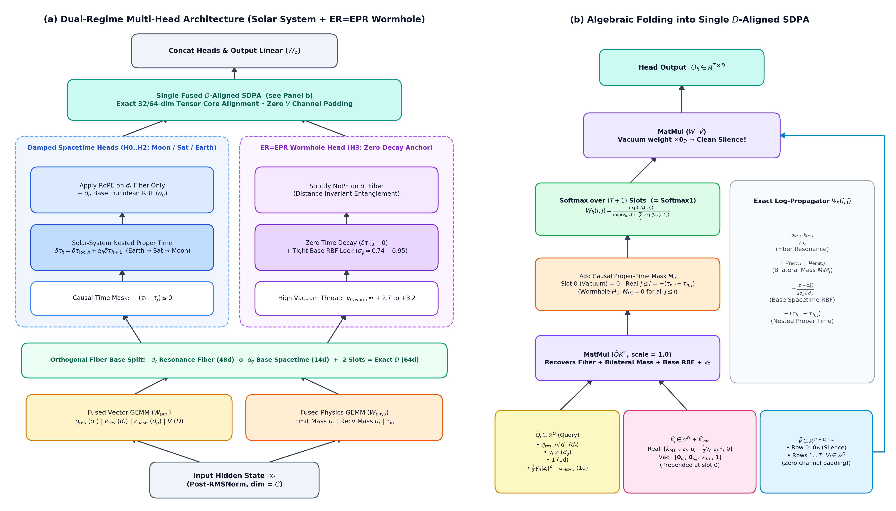

<div align="center">

# EPR Attention (Euclidean-RBF, Proper-time & Resonance-fiber)

**Edge-First, High-Density Long-Context Architecture on a Clean Llama 2 Backbone**

**English** | [简体中文](README_zh.md) · [📊 v1.0 Legacy Benchmarks & Samples](docs/BENCHMARKS.md) · [🏷️ v1.0 Release Tag](https://github.com/Dracen-W/llama2-wormhole-gravity/releases/tag/1.0)

[](LICENSE)
[](NOTICE)
[](audit_all.py)

</div>

> **Attribution:** Built with the **Meta Llama 2** architecture (Touvron et al., 2023) on top of Andrej Karpathy's [`llama2.c`](https://github.com/karpathy/llama2.c) (MIT License). See [`LICENSE`](LICENSE), [`NOTICE`](NOTICE), and [`CITATION.bib`](CITATION.bib) for full license and citation terms.

> **🚧 Active Speed & Kernel Optimization Notice:** All 1.3M–28M benchmark scores below are **legacy baseline results from [`v1.0`](https://github.com/Dracen-W/llama2-wormhole-gravity/releases/tag/1.0)** (measured on the unoptimized PyTorch `SDPA` backend with an explicit $O(T^2)$ time mask). We are actively upgrading the architecture to **PyTorch `FlexAttention` + Native GQA + Asymmetric Edge KV-Cache (`EPRKVCache`)**. Early 1.1B hardware benchmarks on NVIDIA L4 already show **`Prefill@2k` surpassing FlashAttention-2 (`18,765` vs `18,569 tok/s`, `101.1%`)** with **`-20.7M` fewer parameters** and lower peak VRAM.

**EPR Attention** *(formerly Unified Fiber-Gravity & ER=EPR Wormhole Attention)* is an **edge-first, high-density long-context architecture** designed so smaller models can run on everyday consumer GPUs, laptops, and edge devices while punching well above their parameter weight class. By replacing redundant attention parameters with compact geometric priors (**E**uclidean-RBF base spacetime, **P**roper-time nested decay, and **R**esonance-fiber RoPE + ER=EPR wormhole heads), it resolves the classic long-context dilemma: **damped attention extrapolates cleanly but forgets distant details, whereas undamped attention recalls distant needles but explodes beyond training length.**

---

## 1. Architecture Overview



- **Orthogonal Fiber–Base Packing (`d_r + d_g + 2 == head_dim`)**: Splits each head into a directional **Resonance Fiber** ($d_r$) and a low-dim **Base Spacetime RBF** ($d_g$), folding bilateral mass ($M_i M_j$) and vacuum floor ($e^{v_0}$) into **one single $D$-aligned attention call with zero $V$ padding**.
- **Dual-Regime Topology**: Damped **Solar-System Heads** (`Moon → Sat → Earth`) handle local/mid-range modeling with nested dynamic proper time; the **ER=EPR Wormhole Head(s)** use **zero time decay ($\delta\tau \equiv 0$) + NoPE + high vacuum throat ($v_0 \approx +2.5$) + tight RBF lock** to stay silent on noise yet instantaneously retrieve exact distant needles.
- **FlexAttention + Asymmetric Edge KV-Cache (`EPRKVCache`)**: Eliminates the $O(T^2)$ time-mask memory wall via fused Triton `FlexAttention`, and enables **75%–87.5% KV-cache compression** at inference by evicting distant KV on damped heads while retaining full context only on Wormhole head(s).

---

## 2. Speed Optimization Preview (1.1B Scale on NVIDIA L4)

*Measured on exact TinyLlama-1.1B topology (`dim=2048, 22L, 32Q/4KV GQA, D=64, bfloat16`), comparing standard FlashAttention-2 vs legacy `v1.0` SDPA vs new `FlexAttention + Native GQA`:*

| 1.1B Variant (NVIDIA L4) | Total Params | Train (`T=1024`) | `Prefill@2k` | Peak VRAM | Speed vs FA2 |
| :--- | :---: | :---: | :---: | :---: | :---: |
| **TinyLlama-1.1B (Base, FA2)** | `1100.05M` | `3,504 tok/s` | `18,569 tok/s` | `10.51 GB` | `100.0%` / `100.0%` |
| **EPR-1.1B (`v1.0` Legacy SDPA)** | `1079.33M` (`-20.7M`) | `1,247 tok/s` | `2,462 tok/s` | `10.37 GB` | `35.6%` / `13.3%` |
| **EPR-1.1B (`FlexAttention` + GQA)** | **`1079.33M` (`-20.7M`)** | **`3,399 tok/s`** (`2.73×`) | **`18,765 tok/s`** (`7.62×`) | **`10.32 GB`** | **`97.0%` / `101.1%`** |

---

## 3. Legacy [`v1.0`](https://github.com/Dracen-W/llama2-wormhole-gravity/releases/tag/1.0) Benchmark Summary (`1.3M → 28M`)

> 📌 **Note:** The results below are **legacy accuracy baselines from release [`v1.0`](https://github.com/Dracen-W/llama2-wormhole-gravity/releases/tag/1.0)** (pre-FlexAttention `SDPA` backend, verified `0.00e+00` future leakage in `float64`). Full tables, Iso-Wallclock curves, and samples are archived in [`docs/BENCHMARKS.md`](docs/BENCHMARKS.md).

| Benchmark (`dim/L/H`, Vocab) | Model | Decayed Params | Train PPL (`T=512`) | 4× Extrap (`T=2048`) | `Dist=1536` Needle / BLEU |
| :--- | :--- | :---: | :---: | :---: | :---: |
| **6.0M WikiText-2** (`256/6L/4H`, 4K) | Pure Llama 2 / FoX (ICLR'25) | `5.87M` / `5.87M` | `47.98` / `44.88` | `96.23` / `43.05` | `13.5% (+0.09)` / `23.7% (+0.00)` |
| **6.0M WikiText-2** (`256/6L/4H`, 4K) | **EPR (`v1.0`)** | **`5.77M`** (`-94K`) | **`37.50`** | **`34.72`** (`-19.3% vs FoX`) | **`32.3% (+0.59)`** |
| **6.0M TinyStories** (`256/6L/4H`, 4K) | Pure Llama 2 vs **EPR (`v1.0`)** | `5.87M` vs **`5.77M`** | `5.50` vs **`5.20`** | `28.67` vs **`4.90`** (`-82.9%`) | `16.4%` vs **`32.6%`** |
| **6.8M FineWeb-Edu** (`256/6L/4H`, 8K) | Pure Llama 2 vs **EPR (`v1.0`)** | `6.91M` vs **`6.82M`** | `37.52` vs **`34.87`** | `161.27` vs **`32.29`** (`-80.0%`) | `9.6% (+0.13)` vs **`29.2% (+0.55)`** |
| **27.6M RealWorld** (`512/6L/8H`, 16K) | Pure Llama 2 vs **EPR (`v1.0`)** | `27.66M` vs **`27.28M`** | `38.24` vs **`34.95`** | `175.29` vs **`32.26`** (`-81.6%`) | `10.4% (+0.12)` vs **`41.1% (+1.34)`** |
| **6.8M WMT14 En→De** (`256/6L/4H`, 8K) | Pure Llama 2 vs **EPR (`v1.0`)** | `6.91M` vs **`6.82M`** | `36.63` vs **`32.69`** | — | **BLEU: `4.32` vs `5.27` (`+22.0%`)** |
| **7.9M Zero-Shot De↔Fr** (`256/6L/4H`, 12K) | Pure Llama 2 vs **EPR (`v1.0`)** | `7.96M` vs **`7.87M`** | `52.33` vs **`47.94`** | — | **De→Fr `+41.1%` / Fr→De `+42.1%`** |

---

## 4. Core Equation & Quick Start

$$\Psi_h(i, j) = \underbrace{\frac{q_{\text{res},i}\cdot k_{\text{res},j}}{\sqrt{d_r}}}_{\text{Resonance Fiber}} + \underbrace{u_{\text{recv},i} + u_{\text{emit},j}}_{\text{Bilateral Mass } M_i M_j} - \underbrace{\frac{\|z_i - z_j\|_2^2}{2\sigma_h^2\sqrt{d_g}}}_{\text{Euclidean-RBF}} - \underbrace{(\tau_{h,i} - \tau_{h,j})}_{\text{Proper-Time}}, \qquad W_h(i, j) = \frac{e^{\Psi_h(i, j)}}{e^{v_{0,h}} + \sum_{k \le i} e^{\Psi_h(i, k)}}$$

```bash
# 1. Run 6-pillar fp64 causality & mathematical parity audit (~3 seconds)
python3 run_all_tests.py --mode=audit

# 2. Benchmark FlexAttention speedup & Asymmetric EPRKVCache memory savings (75% - 87.5%)
python3 bench_epr_speed.py

# 3. One-click full benchmark suites (WikiText-2 / WMT14 / Zero-Shot De<->Fr / 28M RealWorld)
python3 run_all_tests.py --mode=wikitext2
```

---

## 5. License & Citation

- **License**: MIT License (preserving Andrej Karpathy's original `llama2.c` copyright; see [`LICENSE`](LICENSE) and [`NOTICE`](NOTICE) for Meta Llama 2 compliance).
- **Citation**: Click **"Cite this repository"** in the right sidebar ([`CITATION.cff`](CITATION.cff)) or copy below:

```bibtex
@misc{dracenw2026epr,
  title        = {EPR Attention: Euclidean-RBF, Proper-time and Resonance-fiber Attention},
  author       = {Dracen-W},
  year         = {2026},
  howpublished = {\url{https://github.com/Dracen-W/llama2-wormhole-gravity}},
  note         = {Built on karpathy/llama2.c and the Meta Llama 2 architecture}
}
```
