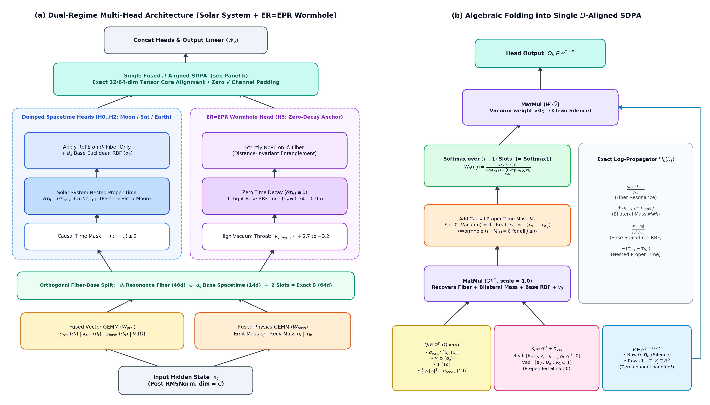
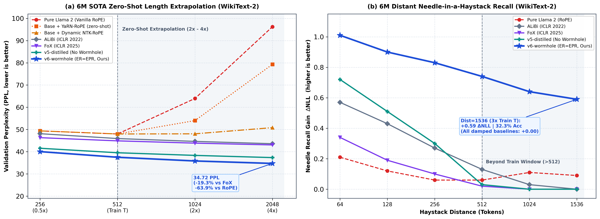
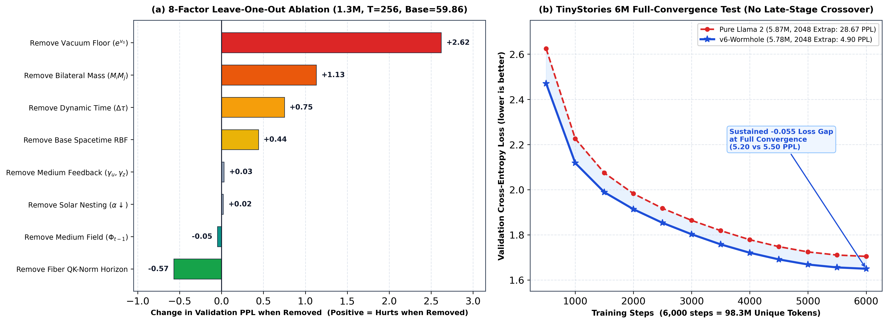

<div align="center">

# 统一纤维—引力与 ER=EPR 虫洞注意力机制 (v6)

**基于纯正 Llama 2 底座的第一性原理物理长上下文架构**

[English](README.md) | **简体中文**

[](LICENSE)
[](NOTICE)
[](audit_all.py)

</div>

> **归属与协议声明：** 本项目基于 **Meta Llama 2** 架构（Touvron et al., 2023）与 Andrej Karpathy 的 [`llama2.c`](https://github.com/karpathy/llama2.c)（MIT License）构建。完整许可与学术引用见 [`LICENSE`](LICENSE)、[`NOTICE`](NOTICE) 与 [`CITATION.bib`](CITATION.bib)。

**统一纤维—引力与 ER=EPR 虫洞注意力机制（`v6-wormhole`）** 以理论物理中的纤维丛规范—引力耦合、太阳系嵌套时间膨胀与 ER=EPR 虫洞为第一性原理，在**单次硬件对齐 SDPA** 中彻底打通了长上下文大模型的经典死结：**带时间阻尼的架构外推极稳但容易忘掉超远细节；无阻尼的架构能捞回远处细节但超出训练长度就会外推崩盘。**

在**衰减权重比纯正 Llama 2 还少 `1.6%`**、且通过 **`float64` 四层防作弊因果审计（未来泄露严格为 `0.00e+00`）** 的前提下，`v6-wormhole` 同时实现：
- **4× 零样本长度外推全面碾压 SOTA**：在 WikiText-2（`6M, Train T=512 -> Eval 2048`）上达到 **`34.72` PPL**，比 **FoX (ICLR 2025)** 低 **19.3%**（`43.05`），比纯正 Llama 2 低 **63.9%**（`96.23`）。
- **3× 长度大海捞针满血回忆（`Dist=1536`）**：保持 **`32.3%` Top-1 准确率（`+0.59 ΔNLL`）**，而 ALiBi、FoX 与纯阻尼消融组全部衰减归零（**`+0.00 ΔNLL`**）。
- **TinyStories 极限收敛无后期反超（`6,000 步 / 98.3M 独立 Token`）**：训内压至 `5.20` vs `5.50` PPL，`2048` 长度外推达到 **`4.90` vs `28.67`（低 82.9%）**。

---

## 一、 架构原理图解



### 核心工作机制（单次严格 $D$ 维对齐融合 SDPA）
1. **正交纤维—底时空精确切分（$d_r + d_g + 2 \equiv D$，零硬件对齐税）**：
   将每个宽度为 $D$（如 `32` 或 `64`）的注意力头正交拆分为两部分：
   - **高维内部共振纤维（$q_{\text{res}}, k_{\text{res}} \in \mathbb{R}^{d_r}$）**：负责定向语法与特征匹配（`D=32` 时取 `24d`；`D=64` 时取 `48d`），彻底消除全维欧氏 RBF 的“全维连坐”缺陷。
   - **低维底时空流形（$z_{\text{base}} \in \mathbb{R}^{d_g}$）**：负责各向同性欧氏 RBF 通用引力捕获（`D=32` 时取 `6d`；`D=64` 时取 `14d`）。因为每个 token 在底时空共享同一组坐标，总衰减权重反而比纯正 Llama 2 更少。
   - **+2 增广引力与真空槽**：通过代数恒等折叠，把双边引力质量（$u_i + u_j$）、欧氏 RBF 二次范数项（$-\frac{1}{2}\|z_i\|^2 - \frac{1}{2}\|z_j\|^2$）和真空底噪（$e^{v_{0,h}}$）严丝合缝塞进**单次 `D` 维对齐的 `F.scaled_dot_product_attention`**，`V` 通道零补零。
2. **双态时空拓扑（太阳系嵌套阻尼 + ER=EPR 零衰减虫洞）**：
   - **阻尼时空头（`H0 Moon`、`H1 Sat`、`H2 Earth`）**：纤维空间施加 RoPE，时间轴受自顶向下太阳系嵌套动态固有时间膨胀（$\delta\tau_{h,t} = \delta\tau_{\text{loc},h,t} + \alpha_h \delta\tau_{h+1,t}$）支配，专注极低 PPL 的近中程语言建模与远古噪声清理。
   - **ER=EPR 虫洞头（`H3 Wormhole`）**：**严格零时间衰减（$\delta\tau_{H3} \equiv 0$）+ 严格无位置旋转（NoPE，彻底脱离距离束缚）+ 高真空喉道门槛（$v_0 \approx +2.7\sim+3.2$）+ 紧缩底时空 RBF 锁（$\sigma_g \approx 0.74\sim0.95$）**。平时保持高沉默率绝不污染 `2048` 外推 PPL，一旦极远处的“针”与当前词产生强内容共振击穿 $v_0$，虫洞瞬间打开将旧信息无损扯回。
3. **阻尼泡利排斥解码（Damped Pauli Repulsion）**：
   推理采样阶段注入随时间指数衰减的泡利简并压 $V_{\text{Pauli}}(v, t)$，近程掐死局部复读死循环，远程自然衰减归零以保留跨段实体合法回扣。

---

## 二、 直观实验数据对比

### 2.1 6M 规模 SOTA 全线对撞：4× 长度外推与 3× 大海捞针（WikiText-2）



所有模型共享完全一致的 Llama 2 底座（`dim=256, 6 层, 4 头 (D=64), vocab=4096, Train T=512, 3000 步`，NVIDIA L4 `bfloat16`, `torch.compile=True`）：

| 模型 / 架构 | 衰减权重数 | `PPL@256` | `PPL@512` (训内) | `PPL@1024` (2×) | `PPL@2048` (4×) | `Dist=512` 捞针 | `Dist=1536` 捞针 (3×) |
| :--- | :---: | :---: | :---: | :---: | :---: | :---: | :---: |
| **Pure Llama 2 (Vanilla RoPE)** | `5,865,472` | 49.37 | 47.98 | 63.95 | 96.23 *(崩盘)* | 22.9% (+0.06) | 13.5% (+0.09) |
| **Base + YaRN-RoPE** *(零重训)* | `5,865,472` | 49.37 | 47.98 | 54.00 | 79.30 | — | — |
| **Base + Dynamic NTK-RoPE** *(零重训)* | `5,865,472` | 49.37 | 47.98 | 48.05 | 50.83 | — | — |
| **ALiBi (ICLR 2022)** | `5,865,472` | 48.11 | 45.92 | 44.64 | 43.60 | 27.3% (+0.13) | 22.9% (+0.00) |
| **FoX (ICLR 2025)** | `5,871,616` | 46.32 | 44.88 | 43.86 | 43.05 | 25.3% (+0.02) | 23.7% (+0.00) |
| **v5-distilled** *(无虫洞)* | `5,773,312` | 41.55 | 39.53 | 38.34 | 37.35 | 23.4% (+0.03) | 23.4% (+0.00) |
| **v6-wormhole (ER=EPR, Ours)** | **`5,771,776`** | **40.04** | **37.50** | **35.83** | **34.72** | **37.8% (+0.74)** | **32.3% (+0.59)** |

### 2.2 8 因子留一消融与 TinyStories 极限收敛曲线



**跨规模与窗口 Scaling Law 演进（WikiText-2）：**

| 规模与窗口 | 对比组合 | 衰减权重数 | 训内 PPL | 4× 外推 PPL | 相对 Base 降幅 (训内 / 4×) |
| :---: | :--- | :---: | :---: | :---: | :---: |
| **1.3M / `T=128`** | Pure Llama 2 vs `v5` | `1.33M` vs **`1.31M`** | `75.06` vs **`69.48`** | `115.28` vs **`67.57`** | `-7.4%` / **`-41.4%`** |
| **1.3M / `T=256`** | Pure Llama 2 vs `v5-distilled` | `1.33M` vs **`1.31M`** | `65.02` vs **`59.34`** | `120.63` vs **`58.11`** | `-8.7%` / **`-51.8%`** |
| **6.0M / `T=512`** | Pure Llama 2 vs `v6-wormhole` | `5.87M` vs **`5.77M`** | `47.98` vs **`37.50`** | `96.23` vs **`34.72`** | `-21.8%` / **`-63.9%`** |

**TinyStories 6M 极限收敛测试（`6,000 步 = 98.3M 独立 Token, dropout=0.0`）：**

| 模型 | 衰减权重数 | Step 1000 Val | Step 3000 Val | Step 6000 Val (PPL) | `PPL@1024` (2×) | `PPL@2048` (4×) |
| :--- | :---: | :---: | :---: | :---: | :---: | :---: |
| **Pure Llama 2 (Base)** | `5,865,472` | 2.2258 (9.26) | 1.8638 (6.45) | 1.7045 (5.50) | 12.48 | 28.67 *(崩盘)* |
| **v6-wormhole (Ours)** | **`5,771,776`** | **2.1180 (8.31)** | **1.8023 (6.06)** | **1.6496 (5.20)** | **4.92** | **4.90 (`-82.9%`)** |

---

## 三、 参数规格与硬件对齐表

`UnifiedFiberGravityAttention` 对任意 2 的幂次头宽自动满足 `d_r + d_g + 2 == head_dim`，彻底消灭 Tensor Core 补零浪费：

| 头宽 $D$ | 共振纤维 $d_r$ | 底时空 $d_g$ | 增广引力/真空槽 | 打包总维度 | `V` 补零税 | 相对纯正 Llama 2 权重差 |
| :---: | :---: | :---: | :---: | :---: | :---: | :---: |
| `16` | `10` | `4` | `+2` | **`16`** | `0` | — |
| `32` | `24` | `6` | `+2` | **`32`** | `0` | `1,312,256` (**少 `14,848`**) |
| `64` | `48` | `14` | `+2` | **`64`** | `0` | `5,771,776` (**少 `93,696`**) |
| `128` | `96` | `30` | `+2` | **`128`** | `0` | 严格少于 Base |

**核心开关参数（`model.py` 中的 `ModelArgs`）：**

| 参数名 | 默认值 | 物理与工程作用 |
| :--- | :---: | :--- |
| `use_unified_gravity` | `False` (`v6` 设 `True`) | 总开关（`False` = 逐比特等价 `karpathy/llama2.c` 原版 Llama 2） |
| `use_wormhole` | `True` | 将最慢头（`H-1`）升级为零衰减、NoPE 的 ER=EPR 虫洞头 |
| `wormhole_v0_init` | `2.5` | 虫洞头高真空喉道初始门槛（平时静默，强共振时瞬间开启） |
| `use_base_rbf` | `True` | $d_g$ 维底时空各向同性欧氏 RBF 通用引力捕获 |
| `use_bilateral_mass` | `True` | 双边引力耦合 $u_{\text{recv},i} + u_{\text{emit},j}$（即 $M_i M_j$） |
| `use_time_dilation` | `True` | 数据驱动的动态固有时间流速 $\delta\tau_{h,t} \ge 0$ |
| `use_nested_time` | `True` | 太阳系自顶向下嵌套级联（$\text{Earth} \to \text{Sat} \to \text{Moon}$） |
| `use_attn_vacuum` | `True` | 物理真空底噪 $e^{v_{0,h}}$（Softmax1 质量间隙） |
| `pauli_alpha` / `pauli_halflife` | `1.8` / `16.0` | `sample.py` 中的阻尼泡利排斥解码强度与衰减半衰期 |

---

## 四、 核心公式来源：物理学与学术谱系

统一对数传播子 $\Psi_h(i, j)$ 与解码排斥势的每一项均有清晰的物理学第一性原理与当代学术脉络支撑：

$$\Psi_h(i, j) = \underbrace{\frac{q_{\text{res},i}\cdot k_{\text{res},j}}{\sqrt{d_r}}}_{\text{纤维定向共振}} + \underbrace{u_{\text{recv},i} + u_{\text{emit},j}}_{\text{双边引力质量 } M_i M_j} - \underbrace{\frac{\|z_i - z_j\|_2^2}{2\sigma_h^2\sqrt{d_g}}}_{\text{底时空欧氏 RBF}} - \underbrace{(\tau_{h,i} - \tau_{h,j})}_{\text{太阳系嵌套固有时间}}, \qquad W_h(i, j) = \frac{e^{\Psi_h(i, j)}}{e^{v_{0,h}} + \sum_{k \le i} e^{\Psi_h(i, k)}}$$

| 模块与公式 | 理论物理来源 | 深度学习与学术脉络 |
| :--- | :--- | :--- |
| **正交纤维—底时空切分**（$d_r \oplus d_g$） | **纤维丛 / 规范—引力耦合**：引力在低维底时空通用捕获，内部规范荷在纤维空间按需共振。 | 保留 RoPE（Su et al., 2021）的高维定向检索优势，同时根治全维欧氏 RBF 的“全维连坐”问题。 |
| **底时空欧氏 RBF**（$-\frac{\|z_i-z_j\|^2}{2\sigma_h^2\sqrt{d_g}}$） | 低维欧氏流形上的**高斯引力势 / 热核传播子**。 | 源自 RBF / L2 Multi-Head Attention（Kim et al., 2021），通过下沉到低维 $d_g$ 并代数折叠进标准 SDPA 实现零额外算子开销。 |
| **双边引力质量耦合**（$M_i M_j = e^{u_i + u_j}$） | **牛顿万有引力双体耦合**（$F \propto m_1 m_2$）：相互作用由发射质量与接收需求质量共同决定。 | 接收端质量 $u_i$ 在高需求查询时动态压低真空门槛，且完全折叠进增广槽、零额外 SDPA 维度。 |
| **太阳系嵌套动态固有时间**（$\delta\tau_h = \delta\tau_{\text{loc},h} + \alpha_h \delta\tau_{h+1}$） | **广义相对论引力时间膨胀** + **星系层级势阱嵌套**（地球 $\to$ 卫星 $\to$ 月球）。 | 推广了静态线性偏置（ALiBi, ICLR 2022）与独立动态遗忘门（FoX, ICLR 2025），实现跨尺度级联重置。 |
| **ER=EPR 零衰减虫洞头**（$\delta\tau_{H3}\equiv 0$, NoPE, 高 $v_0$） | **ER = EPR 猜想**（Maldacena & Susskind, 2013）：强纠缠的遥远粒子通过虫洞瞬时相连，绕开常规时空距离。 | 结合 NoPE（Kazemnejad et al., NeurIPS 2023）、高门槛 Softmax1 真空沉默与紧缩底时空 RBF 锁，一举解决阻尼架构远距失忆症。 |
| **物理真空底噪**（分母中 $e^{v_{0,h}}$） | **量子场论质量间隙 / 真空基态**：低于阈值的无关信号自然衰落为零输出静默。 | 源自 Softmax1 / Quiet Attention（Evan Miller, 2023），升级为逐头可学习门槛 $v_{0,h}$ 并折叠进零值 KV 槽。 |
| **阻尼泡利排斥解码**（$V_{\text{Pauli}}(v,t) = \alpha\sum_{s<t,y_s=v} e^{-\lambda(t-s)}$） | **泡利不相容简并压与兰纳-琼斯势平衡**：短程强排斥阻止引力坍缩（复读死循环），远程衰减归零。 | 相比传统硬窗口 `repetition_penalty`，物理平滑衰减不会误伤跨段合法实体回扣。 |

---

## 五、 6 维 `float64` 超强防作弊与数学等价审计

随时运行 `python3 audit_all.py`（或 `--ckpt=权重路径` 对已训练模型验尸）：

| 审计维度 | 验证内容 | 实测指标 |
| :--- | :--- | :---: |
| **1. 纯正 Llama 2 对照** | `use_unified_gravity=False` 严格路由至未修改 `karpathy/llama2.c` Attention | **PASS** |
| **2. 教科书数学等价** | 8 组配置（`D=32/64`、GQA、虫洞与消融）对比逐词循环参考实现 | `fp64` 前向 **`≤ 3.33e-16`**，反向 **`≤ 7.99e-15`** |
| **3. 四层因果膜防作弊** | 前向未来扰动、`fp64` 物理截断、反向雅可比未来梯度、逐词自回归等价 | 未来扰动 **`0.00e+00`**，未来梯度 **`0.00e+00`**，截断 **`≤ 1.07e-14`** |
| **4. 梯度与 4× 压测** | 全参数零死权重，4× 外推与全重复词压测零 NaN/Inf | **PASS** |
| **5. 硬件对齐与参数预算** | `D ∈ {16, 32, 64, 128}` 严格满足 `d_r + d_g + 2 == D` | 6M 档比 Base **少 `93,696` 权重** |
| **6. 泡利排斥解码** | `alpha=0` 与原版比特级一致；强排斥严格掐断紧邻复读 | **PASS** |

---

## 六、 快速上手

```bash
# 1. 运行 6 维超强防作弊审计（约 3 秒）
python3 audit_all.py

# 2. 在 WikiText-2 上训练 6.0M / 512 上下文 v6-Wormhole（Colab L4 约 4 分钟）
python3 train.py config/train_wikitext2_colab_scale.py \
  --use_unified_gravity=True --use_wormhole=True \
  --out_dir=out-6m-v6-wormhole

# 3. 权重防作弊审计 + 物理体检 + 2048 外推 + 1536 大海捞针
python3 audit_all.py --ckpt=out-6m-v6-wormhole/ckpt.pt
python3 inspect_fields.py out-6m-v6-wormhole/ckpt.pt
python3 eval_extrapolation.py out-6m-v6-wormhole --lengths=256,512,1024,2048
python3 eval_needle.py out-6m-v6-wormhole --distances=64,128,256,512,1024,1536

# 4. 开启阻尼泡利排斥采样
python3 sample.py --out_dir=out-6m-v6-wormhole --start="In 1945 , the" --pauli_alpha=1.8 --pauli_halflife=16.0
```

---

## 七、 开源协议与引用规范

- **代码协议**：MIT License（完整保留 Andrej Karpathy 原始 `llama2.c` 版权声明，见 [`LICENSE`](LICENSE)）。
- **Meta Llama 2 声明**：基础架构基于 Meta Llama 2（Touvron et al., 2023）。如使用仓库内附带的 Meta 原始 `tokenizer.model` 或 Meta 预训练权重，须遵守 **Llama 2 Community License Agreement**（详见 [`NOTICE`](NOTICE)）。本仓库 WikiText-2 与 TinyStories 实验均使用从零训练的 4K BPE 分词器。
- **引用本项目**：可直接点击 GitHub 仓库右侧的 **"Cite this repository"**（由 [`CITATION.cff`](CITATION.cff) 自动生成），或复制下方 BibTeX：

```bibtex
@misc{dracenw2026wormhole,
  title        = {Unified Fiber-Gravity and ER=EPR Wormhole Attention},
  author       = {Dracen-W},
  year         = {2026},
  howpublished = {\url{https://github.com/Dracen-W/llama2-wormhole-gravity}},
  note         = {Built on karpathy/llama2.c and the Meta Llama 2 architecture}
}
```
