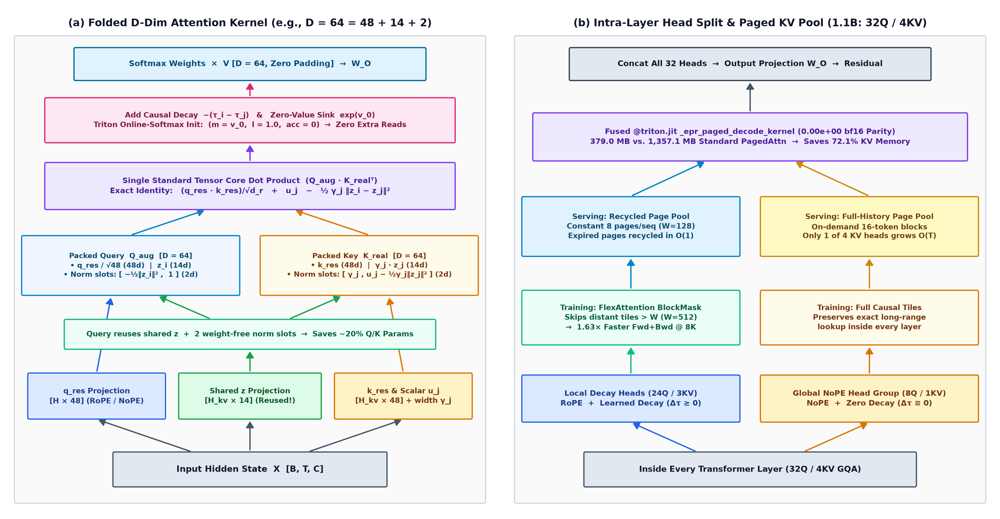

# EPR Attention (`v3.0`) — Visual Architecture & Tensor Walkthrough

This guide walks through the concrete tensor shapes of **EPR Attention** (`1.1B` GQA example: `C = 2048`, `H = 32` query heads, `H_kv = 4` KV heads, `head_dim D = 64`), corresponding directly to [`epr_attention.py`](../epr_attention.py), [`epr_paged_attention.py`](../epr_paged_attention.py), and [`hf_epr.py`](../hf_epr.py). For formal algebraic proofs, see [`MATH.md`](MATH.md).

---

## 1. Tensor Shapes Inside a Single Attention Layer (`48 + 14 + 2 = 64`)

Given input hidden states `X` of shape `[B, T, 2048]`:

1. **Fused Main Vector Projection (`self.w_proj`)**:
   - Instead of projecting full `64d` for every query and key (`32×64 + 4×64 = 2304` columns), EPR projects:
     - `q_res`: `[B, 32, T, 48]` (`1536` columns; `RoPE` applied on heads `0..23`, `NoPE` on global heads `24..31`)
     - `k_res`: `[B, 4, T, 48]` (`192` columns; `RoPE` on KV heads `0..2`, `NoPE` on global KV head `3`)
     - `z_base`: `[B, 4, T, 14]` (`56` columns; **shared** by both Query and Key within each GQA group!)
     - `V`: `[B, 4, T, 64]` (`256` columns; untouched full `64d` value channels, **zero padding**)
2. **Fused Lightweight Scalar Projection (`self.w_phys`)**:
   - Projects `u_emit` (`[B, 4, T]`, key salience/bias) and `tau_in` (`[B, 24, T]`, content-driven decay velocity on the `24` local heads; global heads `24..31` have exact zero decay).
3. **2-Slot Packing into Standard `D = 64` Tensor Core Layout**:
   - Key inverse width: `gamma_j = gamma_0 / (1 + alpha * sigmoid(u_emit_j))` (`[B, 4, T, 1]`).
   - `Q_aug` (`[B, 32, T, 64]`): `[ q_res / sqrt(48),  z_q,  -0.5 * ||z_q||^2,  1.0 ]`
   - `K_real` (`[B, 4, T, 64]`): `[ k_res,  gamma_j * z_base,  gamma_j,  u_emit - 0.5 * gamma_j * ||z_base||^2 ]`
   - Their standard `64d` dot product equals `(q_res · k_res)/sqrt(48) + u_emit_j - 0.5 * gamma_j * ||z_q - z_base||^2` with **zero Softmax shift terms**.

---

## 2. Intra-Layer Local / Global Split (`FlexAttention` & `@triton.jit` PagedAttention)

| Property | Local Decay Heads (`Heads 0..23` / `KV 0..2`) | Global `NoPE` Head Group (`Heads 24..31` / `KV 3`) |
| :--- | :--- | :--- |
| **Positional Encoding** | `RoPE` on `48d` subspace | **`NoPE`** (position-invariant content & L2 matching) |
| **Temporal Decay** | Cumulative `-(tau_i - tau_j) <= 0` | **Exact Zero (`0.0`)** |
| **Training (`FlexAttention`)** | Skips `128×128` tiles beyond `W` (`1.63×` @ `8K`) | Evaluates full causal tiles (`j <= i`) |
| **Serving (`EPRPagedKVCache`)** | **Constant `O(W)` physical pages** (`8` pages/seq at `W=128`, recycled in `O(1)`) | On-demand `16`-token pages (`1/4` of KV heads) |
| **Zero-Value Sink (`exp(v_0)`)** | Low sink bias (`v_0 ≈ -3.5`) | High sink threshold (`v_0 ≈ +1.8..+2.5`) to stay quiet unless matched |

In [`_epr_paged_decode_kernel`](../epr_paged_attention.py), each `(batch, head)` threadblock initializes its online-Softmax accumulators directly at `(m_i = v_0, l_i = 1.0, acc = 0_D)`, folding the zero-value attention sink with **zero global-memory reads** and cutting total allocated `1.1B` continuous-batching KV memory by **`72.1%`** compared to standard PagedAttention.
