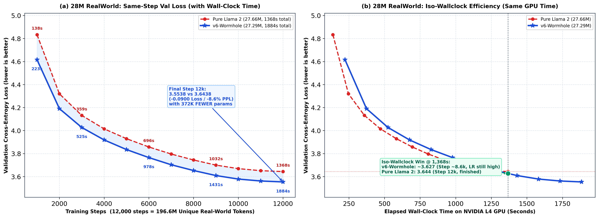
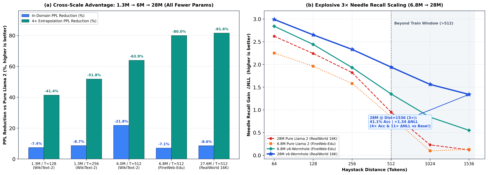
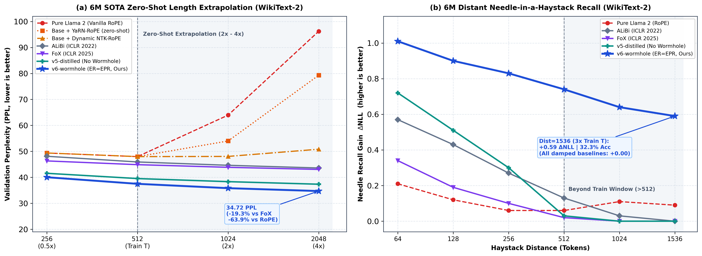
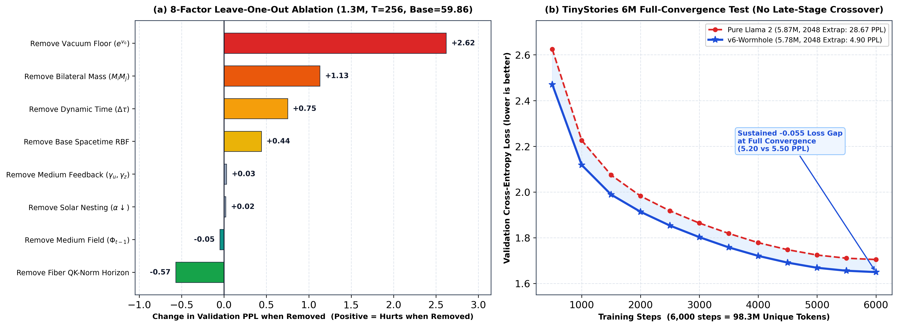

<div align="center">

# Comprehensive Benchmarks, Scaling Laws & Qualitative Samples

[← Back to README](../README.md) | **English** | [简体中文](BENCHMARKS_zh.md)

</div>

This page archives the complete experimental record of **Unified Fiber-Gravity & ER=EPR Wormhole Attention (`v6-wormhole`)** across **4 distinct corpora** (`WikiText-2`, `TinyStories`, `FineWeb-Edu`, `RealWorld 16K`), **3 model scales** (`1.3M → 6.8M → 27.6M`), **SOTA baselines** (`Vanilla RoPE`, `YaRN`, `Dynamic NTK`, `ALiBi`, `FoX`), **Iso-Wallclock efficiency**, and **qualitative text samples**.

---

## Table of Contents
1. [Panoramic Summary Across All 4 Corpora](#panoramic-summary)
2. [Same-Step & Iso-Wallclock Efficiency (28M RealWorld)](#iso-wallclock)
3. [Cross-Scale Scaling Law & 28M Distant Needle Recall](#scaling-law)
4. [6M SOTA Showdown (WikiText-2: RoPE / YaRN / NTK / ALiBi / FoX)](#sota-showdown)
5. [8-Factor Leave-One-Out Ablation & TinyStories Convergence](#ablation-convergence)
6. [Qualitative Text Generation Samples](#samples)
7. [Corpus Recipes & Reproduction Commands](#corpora)

---

<a id="panoramic-summary"></a>
## 1. Panoramic Summary Across All 4 Corpora (NVIDIA L4, `bfloat16`)

Every `v6-wormhole` model uses **strictly fewer decayed parameters** than its Pure Llama 2 control baseline and passes the `float64` 4-layer zero-leakage causality audit (`0.00e+00` future perturbation & gradient).

| Scale & Corpus | Vocab | Train Steps (Tokens) | Model | Decayed Params | Train-Len PPL (`T=512`) | 4× Extrap PPL (`T=2048`) | `Dist=1536` Needle (3×) |
| :--- | :---: | :---: | :--- | :---: | :---: | :---: | :---: |
| **1.3M / WikiText-2** (`T=128`) | 4K | 3,000 (24.6M) | Pure Llama 2 vs **`v5`** | `1.33M` vs **`1.31M`** | `75.06` vs **`69.48`** (`-7.4%`) | `115.28` vs **`67.57`** (`-41.4%`) | — |
| **1.3M / WikiText-2** (`T=256`) | 4K | 3,000 (24.6M) | Pure Llama 2 vs **`v5-dist`** | `1.33M` vs **`1.31M`** | `65.02` vs **`59.34`** (`-8.7%`) | `120.63` vs **`58.11`** (`-51.8%`) | — |
| **6.0M / WikiText-2** | 4K | 3,000 (49.2M) | Pure Llama 2 vs **`v6-wormhole`** | `5.87M` vs **`5.77M`** | `47.98` vs **`37.50`** (`-21.8%`) | `96.23` vs **`34.72`** (`-63.9%`) | `13.5% (+0.09)` vs **`32.3% (+0.59)`** |
| **6.0M / TinyStories** | 4K | 6,000 (98.3M) | Pure Llama 2 vs **`v6-wormhole`** | `5.87M` vs **`5.77M`** | `5.50` vs **`5.20`** (`-5.5%`) | `28.67` vs **`4.90`** (`-82.9%`) | `16.4%` vs **`32.6%`** *(2× Acc)* |
| **6.8M / FineWeb-Edu** | 8K | 15,000 (245.8M) | Pure Llama 2 vs **`v6-wormhole`** | `6.91M` vs **`6.82M`** | `37.52` vs **`34.87`** (`-7.1%`) | `161.27` vs **`32.29`** (`-80.0%`) | `9.6% (+0.13)` vs **`29.2% (+0.55)`** |
| **27.6M / RealWorld 16K** | 16K | 12,000 (196.6M) | Pure Llama 2 vs **`v6-wormhole`** | `27.66M` vs **`27.28M`** | `38.24` vs **`34.95`** (`-8.6%`) | `175.29` vs **`32.26`** (`-81.6%`) | `10.4% (+0.12)` vs **`41.1% (+1.34)`** |

---

<a id="iso-wallclock"></a>
## 2. Same-Step & Iso-Wallclock Efficiency (28M RealWorld 16K)



**Key Wall-Clock Findings on NVIDIA L4 (`dim=512, 6L, 8H, head_dim=64, B=32, T=512`):**
- **Step-time overhead shrinks with width**: At `dim=256 (6.8M)`, `v6-wormhole` takes `1.51×` per step (`60ms` vs `40ms`); at `dim=512 (28M)`, FFN GEMMs dominate and `v6-wormhole` drops to **`1.35×`** per step (`148ms` vs `110ms`) while using **371,712 fewer decayed weights**.
- **Iso-Wallclock Victory at 1,368s**: Pure Llama 2 finishes all 12,000 steps (LR fully annealed to `1e-5`) in **`1,367.8s`** at **`3.6438` (PPL `38.24`)**. At the exact same elapsed GPU time (`1,367.8s`), `v6-wormhole` is only at Step ~8,580 (with LR still high at `~1.3e-4`) yet has already surpassed Base at **`~3.627` (PPL `~37.6`)** — before continuing down to **`3.5538` (PPL `34.95`)**.

| Step | Pure Llama 2 Val Loss (PPL) | Base Elapsed | `v6-wormhole` Val Loss (PPL) | `v6` Elapsed | Loss Advantage ($\Delta$) |
| :---: | :---: | :---: | :---: | :---: | :---: |
| **1,000** | 4.8335 (125.65) | 137.9s | **4.6159 (101.08)** | 222.8s | `-0.2176` |
| **3,000** | 4.1318 (62.29) | 359.2s | **4.0271 (56.10)** | 524.6s | `-0.1047` |
| **6,000** | 3.8575 (47.34) | 695.5s | **3.7653 (43.17)** | 977.7s | `-0.0922` |
| **9,000** | 3.6998 (40.44) | 1031.8s | **3.6092 (36.94)** | 1430.8s | `-0.0906` |
| **12,000** | 3.6438 (38.24) | 1367.8s | **3.5538 (34.95)** | 1884.0s | **`-0.0900` (`-8.6%` PPL)** |

---

<a id="scaling-law"></a>
## 3. Cross-Scale Scaling Law & 28M Distant Needle Recall



**Is the advantage a fixed ratio or accelerating?**
1. **In-Domain Modeling (Steadily Widening Super-Constant Margin)**: On large unique-token corpora, the asymptotic loss gap widens from **`-0.0734` (`-7.1%` PPL)** at `6.8M` (FineWeb-Edu) to **`-0.0900` (`-8.6%` PPL)** at `27.6M` (RealWorld 16K). There is no "small-model ceiling."
2. **Long-Context Extrapolation & 3× Needle Recall (Explosive Widening)**:
   - At `4×` length (`T=2048`), Pure Llama 2's collapse worsens with scale (`96.23 → 161.27 → 175.29`), while `v6-wormhole` monotonically improves (`34.72 → 32.29 → 32.26`).
   - At `3×` needle distance (`Dist=1536`), scaling from `6.8M` to `28M` boosts `v6-wormhole` from `29.2% (+0.55 ΔNLL)` to **`41.1% (+1.34 ΔNLL)`** — **4× the accuracy and 11× the recall gain** of 28M Pure Llama 2 (`10.4% / +0.12 ΔNLL`).

| 28M RealWorld Needle Distance | `Dist=64` | `Dist=128` | `Dist=256` | `Dist=512` | `Dist=1024` (2×) | `Dist=1536` (3×) |
| :--- | :---: | :---: | :---: | :---: | :---: | :---: |
| **28M Pure Llama 2 (RoPE)** | 56.8% (+2.62) | 51.0% (+2.24) | 49.2% (+1.82) | 33.6% (+0.95) | 12.5% (+0.23) | 10.4% (+0.12) |
| **28M v6-wormhole (Ours)** | **62.8% (+2.99)** | **57.8% (+2.65)** | **51.8% (+2.33)** | **49.7% (+1.94)** | **44.8% (+1.56)** | **41.1% (+1.34)** |

---

<a id="sota-showdown"></a>
## 4. 6M SOTA Showdown (WikiText-2: RoPE / YaRN / NTK / ALiBi / FoX)



All models trained on identical `dim=256, 6L, 4H (D=64), vocab=4096, Train T=512, 3000 steps`:

| Architecture | Decayed Params | `PPL@256` | `PPL@512` (Train) | `PPL@1024` (2×) | `PPL@2048` (4×) | `Dist=512` Needle | `Dist=1536` Needle (3×) |
| :--- | :---: | :---: | :---: | :---: | :---: | :---: | :---: |
| **Pure Llama 2 (Vanilla RoPE)** | `5,865,472` | 49.37 | 47.98 | 63.95 | 96.23 | 22.9% (+0.06) | 13.5% (+0.09) |
| **Base + YaRN-RoPE** *(zero-shot)* | `5,865,472` | 49.37 | 47.98 | 54.00 | 79.30 | — | — |
| **Base + Dynamic NTK-RoPE** *(zero-shot)* | `5,865,472` | 49.37 | 47.98 | 48.05 | 50.83 | — | — |
| **ALiBi (ICLR 2022)** | `5,865,472` | 48.11 | 45.92 | 44.64 | 43.60 | 27.3% (+0.13) | 22.9% (+0.00) |
| **FoX (ICLR 2025)** | `5,871,616` | 46.32 | 44.88 | 43.86 | 43.05 | 25.3% (+0.02) | 23.7% (+0.00) |
| **v5-distilled** *(no wormhole)* | `5,773,312` | 41.55 | 39.53 | 38.34 | 37.35 | 23.4% (+0.03) | 23.4% (+0.00) |
| **v6-wormhole (ER=EPR, Ours)** | **`5,771,776`** | **40.04** | **37.50** | **35.83** | **34.72** | **37.8% (+0.74)** | **32.3% (+0.59)** |

---

<a id="ablation-convergence"></a>
## 5. 8-Factor Leave-One-Out Ablation & TinyStories Convergence



- **Ablation (`1.3M, T=256`)**: Removing Vacuum (`+2.62 PPL`), Bilateral Mass (`+1.13 PPL`), Dynamic Proper Time (`+0.75 PPL`), or Base RBF (`+0.44 PPL`) severely degrades quality, whereas removing QK-Norm Event Horizon (`-0.57 PPL`) and explicit Medium Field (`-0.05 PPL`) *improves* both accuracy and speed — yielding the distilled `v5/v6` physics core.
- **TinyStories (`6M, 6,000 steps / 98.3M tokens`)**: `v6-wormhole` maintains a rock-solid `-0.055` loss advantage all the way to step 6,000 (`5.20` vs `5.50` PPL) with zero late-stage crossover, and achieves **`4.90` vs `28.67`** at 4× extrapolation.

---

<a id="samples"></a>
## 6. Qualitative Text Generation Samples (Unedited, `seed=42, temp=0.7, top_k=40`)

### 6.1 28M RealWorld 16K — Documentary Prompt (`"In July 1969, NASA launched Apollo 11"`)

**Pure Llama 2 (27.66M, standard decoding — collapses into F-37S repetition loop):**
> In July 1969, NASA launched Apollo 11, the first space shuttle mission to launch the Saturn V-17 rocket of the F-35S. In April 1969, the F-37S rocket was launched into orbit. The mission was the first to launch a rocket of the time that would be launched at the time by the F-37S rocket of the United States. On 7 October 1970, the F-37S rocket was launched by F-37S. On 10 October 1969, the F-37S rocket was launched at the F-36S rocket...

**`v6-wormhole` (27.29M, Damped Pauli Repulsion `alpha=1.4, halflife=16t` — zero loops, coherent documentary register):**
> In July 1969, NASA launched Apollo 11, the first space flight in the United States to fly during the transition of spaceflight to a new orbitor. (The spacecraft had only one aircraft or more of its crew) they could fly before their flying was completed. (The spacecraft would be able to fly at the same altitude as it was in the winter of 1969.) In July 1970, NASA began a flight of four aircraft from the moon to a new orbitor. The spacecraft was about 10 feet long and could fly at only one distance from Earth, with the launch of a flight that would take approximately 3 billion miles (370,000 kilometers)...

### 6.2 6M TinyStories — Narrative Prompt (`"Once upon a time, there was a little girl named Lily who found a secret key"`)

**Pure Llama 2 (5.87M — physical commonsense breakdown):**
> ...She was very excited to open it and see what was inside. But when she opened it, she saw that it was locked! She searched and searched, but she couldn't find the key.

**`v6-wormhole` (5.78M, `pauli_alpha=1.0, halflife=12t` — coherent causal chain):**
> ...She unlocked the door of her house and ran outside to see her friend, Timmy. Timmy started to play with Lily and she had so much fun finding the key. But then, she heard a loud noise and a big dog came running towards her. Timmy got scared and ran away, but Lily was too fast and caught him...

---

<a id="corpora"></a>
## 7. Corpus Recipes & Reproduction Commands

All corpora are prepared with zero external manual downloads via HuggingFace streaming scripts in `scripts/`:

| Dataset | Composition | Vocab | Prep Script | Training Config |
| :--- | :--- | :---: | :--- | :--- |
| **WikiText-2** | Pre-packaged in `data/wikitext2/` | 4,096 | `data/wikitext2/prepare.py` | `config/train_wikitext2_colab_scale.py` |
| **TinyStories** | `roneneldan/TinyStories` (500K stories, ~110M tok) | 4,096 | `scripts/prepare_tinystories_bpe.py` | `config/train_tinystories_6m_converge.py` |
| **FineWeb-Edu** | `HuggingFaceFW/fineweb-edu` (`sample-10BT`, 260M tok) | 8,192 | `scripts/prepare_fineweb_edu.py` | `config/train_fineweb_edu_extreme.py` |
| **RealWorld 16K** | **45% FineWeb-Edu + 35% English Wikipedia + 20% CNN/DM News** (210M tok) | 16,384 | `scripts/prepare_realworld_16k.py` | `config/train_realworld_28m.py` |

```bash
# Example: Reproduce the 28M RealWorld 16K benchmark on Colab L4
python3 scripts/prepare_realworld_16k.py
python3 train.py config/train_realworld_28m.py --use_unified_gravity=False --out_dir=out-rw-28m-base
python3 train.py config/train_realworld_28m.py --use_unified_gravity=True --use_wormhole=True --out_dir=out-rw-28m-v6-wormhole
python3 eval_extrapolation.py out-rw-28m-base out-rw-28m-v6-wormhole --lengths=256,512,1024,2048
python3 eval_needle.py out-rw-28m-base out-rw-28m-v6-wormhole --distances=64,128,256,512,1024,1536
```
