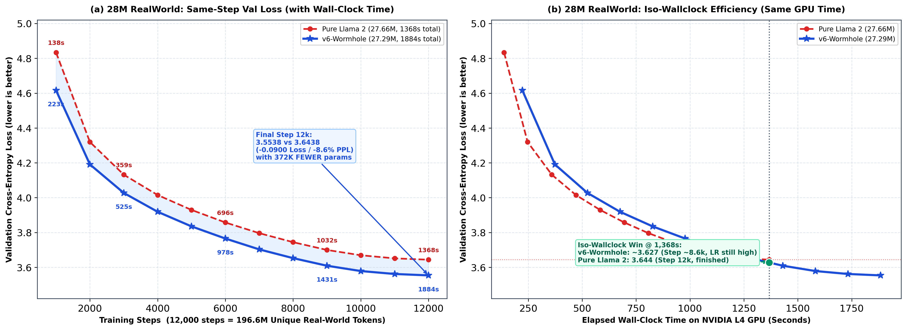
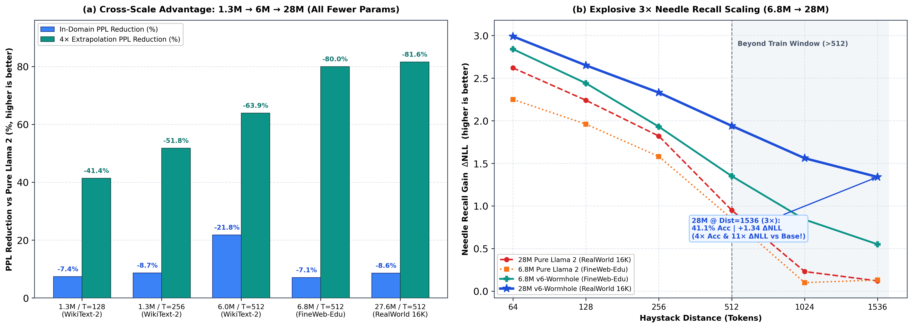
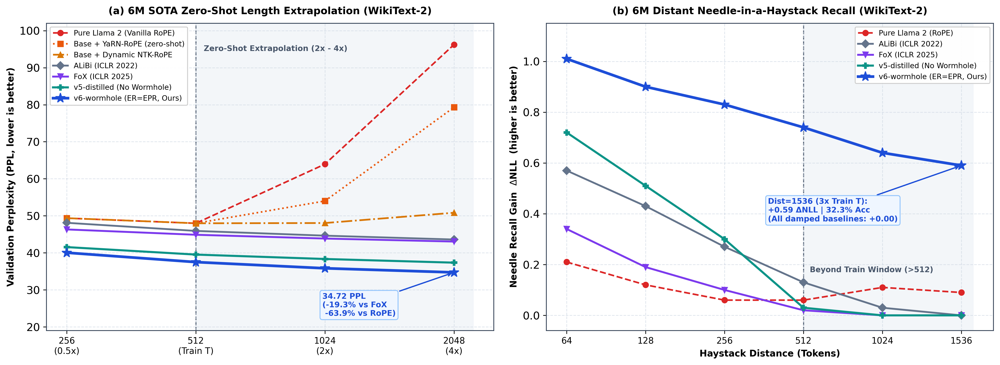

<div align="center">

# 完整基准测试、Scaling Law 与真实文本样本档案

[← 返回中文主页](../README_zh.md) | [English](BENCHMARKS.md) | **简体中文**

</div>

本页面完整归档了 **统一纤维—引力与 ER=EPR 虫洞注意力机制（`v6-wormhole`）** 在 **4 大语料库**（`WikiText-2`、`TinyStories`、`FineWeb-Edu`、`RealWorld 16K`）、**3 档参数规模**（`1.3M → 6.8M → 27.6M`）、**SOTA 强基线对撞**（`Vanilla RoPE`、`YaRN`、`Dynamic NTK`、`ALiBi`、`FoX`）、**同耗时（Iso-Wallclock）效率** 以及 **真实生成样本** 上的全部实测数据。

---

## 目录
1. [四大语料库全景总表](#panoramic-summary)
2. [同步数（标注耗时）与同耗时（Iso-Wallclock）效率分析（28M）](#iso-wallclock)
3. [跨规模 Scaling Law 与 28M 大海捞针爆发](#scaling-law)
4. [6M SOTA 强基线全线对撞（WikiText-2）](#sota-showdown)
5. [8 因子留一消融与 TinyStories 极限收敛](#ablation-convergence)
6. [真实文本生成样本盲测对比](#samples)
7. [语料配方与一键复现命令](#corpora)

---

<a id="panoramic-summary"></a>
## 一、 四大语料库全景总表（NVIDIA L4, `bfloat16`）

所有 `v6-wormhole` 模型均使用**严格少于纯正 Llama 2 的衰减权重**，且全部通过 `float64` 四层防作弊因果审计（未来扰动与未来梯度严格为 `0.00e+00`）。

| 规模与语料 | 词表 | 训练步数 (Token) | 对比组合 | 衰减权重数 | 训内 PPL (`T=512`) | 4× 外推 PPL (`T=2048`) | `Dist=1536` 捞针 (3×) |
| :--- | :---: | :---: | :--- | :---: | :---: | :---: | :---: |
| **1.3M / WikiText-2** (`T=128`) | 4K | 3,000 (24.6M) | Pure Llama 2 vs **`v5`** | `1.33M` vs **`1.31M`** | `75.06` vs **`69.48`** (`-7.4%`) | `115.28` vs **`67.57`** (`-41.4%`) | — |
| **1.3M / WikiText-2** (`T=256`) | 4K | 3,000 (24.6M) | Pure Llama 2 vs **`v5-dist`** | `1.33M` vs **`1.31M`** | `65.02` vs **`59.34`** (`-8.7%`) | `120.63` vs **`58.11`** (`-51.8%`) | — |
| **6.0M / WikiText-2** | 4K | 3,000 (49.2M) | Pure Llama 2 vs **`v6-wormhole`** | `5.87M` vs **`5.77M`** | `47.98` vs **`37.50`** (`-21.8%`) | `96.23` vs **`34.72`** (`-63.9%`) | `13.5% (+0.09)` vs **`32.3% (+0.59)`** |
| **6.0M / TinyStories** | 4K | 6,000 (98.3M) | Pure Llama 2 vs **`v6-wormhole`** | `5.87M` vs **`5.77M`** | `5.50` vs **`5.20`** (`-5.5%`) | `28.67` vs **`4.90`** (`-82.9%`) | `16.4%` vs **`32.6%`** *(2× 准确率)* |
| **6.8M / FineWeb-Edu** | 8K | 15,000 (245.8M) | Pure Llama 2 vs **`v6-wormhole`** | `6.91M` vs **`6.82M`** | `37.52` vs **`34.87`** (`-7.1%`) | `161.27` vs **`32.29`** (`-80.0%`) | `9.6% (+0.13)` vs **`29.2% (+0.55)`** |
| **27.6M / RealWorld 16K** | 16K | 12,000 (196.6M) | Pure Llama 2 vs **`v6-wormhole`** | `27.66M` vs **`27.28M`** | `38.24` vs **`34.95`** (`-8.6%`) | `175.29` vs **`32.26`** (`-81.6%`) | `10.4% (+0.12)` vs **`41.1% (+1.34)`** |

---

<a id="iso-wallclock"></a>
## 二、 同步数（标注耗时）与同耗时（Iso-Wallclock）效率分析（28M）



**NVIDIA L4 实测耗时结论（`dim=512, 6层, 8头, head_dim=64, B=32, T=512`）：**
- **模型越宽，单步开销越小**：在 `6.8M (dim=256)` 档，`v6-wormhole` 单步耗时是 Base 的 `1.51×`（`60ms` vs `40ms`）；扩到 `28M (dim=512)` 后，FFN 大矩阵乘法占主导，`v6-wormhole` 单步耗时降至 Base 的 **`1.35×`**（`148ms` vs `110ms`），同时衰减权重还比 Base **少 `371,712` 个**。
- **同墙钟时间（Iso-Wallclock @ 1,368s）实现反超**：Pure Llama 2 跑满 12,000 步（学习率退火至 `1e-5`）总耗时 **`1,367.8s`**，最终停在 **`3.6438`（PPL `38.24`）**；同一时刻（`1,367.8s`），`v6-wormhole` 仅跑到约 Step 8,580（学习率仍高达 `~1.3e-4`），Val Loss 就已压至 **`~3.627`（PPL `~37.6`）** 完成反杀，跑满 12,000 步后更进一步压到 **`3.5538`（PPL `34.95`）**。

| 训练步数 | Pure Llama 2 Val Loss (PPL) | Base 耗时 | `v6-wormhole` Val Loss (PPL) | `v6` 耗时 | Loss 优势 ($\Delta$) |
| :---: | :---: | :---: | :---: | :---: | :---: |
| **1,000** | 4.8335 (125.65) | 137.9s | **4.6159 (101.08)** | 222.8s | `-0.2176` |
| **3,000** | 4.1318 (62.29) | 359.2s | **4.0271 (56.10)** | 524.6s | `-0.1047` |
| **6,000** | 3.8575 (47.34) | 695.5s | **3.7653 (43.17)** | 977.7s | `-0.0922` |
| **9,000** | 3.6998 (40.44) | 1031.8s | **3.6092 (36.94)** | 1430.8s | `-0.0906` |
| **12,000** | 3.6438 (38.24) | 1367.8s | **3.5538 (34.95)** | 1884.0s | **`-0.0900` (`-8.6%` PPL)** |

---

<a id="scaling-law"></a>
## 三、 跨规模 Scaling Law 与 28M 大海捞针爆发



**优势是固定比例，还是加速放大？**
1. **训内语言建模（稳步走阔的超恒定红利）**：在海量不重复真实语料上，收敛谷底的 Loss 代差从 `6.8M`（FineWeb-Edu）的 **`-0.0734`（`-7.1%` PPL）** 进一步扩大到 `27.6M`（RealWorld 16K）的 **`-0.0900`（`-8.6%` PPL）**，完全没有小模型天花板。
2. **4× 外推与 3× 大海捞针（爆发式放大）**：
   - 在 `4×` 长度（`T=2048`）下，Pure Llama 2 越扩规模崩得越惨（`96.23 → 161.27 → 175.29`），而 `v6-wormhole` 单调走低（`34.72 → 32.29 → 32.26`）。
   - 在 `3×` 捞针距离（`Dist=1536`）下，从 `6.8M` 扩到 `28M` 后，`v6-wormhole` 的超远捞针从 `29.2% (+0.55 ΔNLL)` 暴涨至 **`41.1% (+1.34 ΔNLL)`**——准确率是 28M Pure Llama 2（`10.4% / +0.12`）的 **4 倍**，回忆增益是其 **11 倍**。

| 28M RealWorld 捞针距离 | `Dist=64` | `Dist=128` | `Dist=256` | `Dist=512` | `Dist=1024` (2×) | `Dist=1536` (3×) |
| :--- | :---: | :---: | :---: | :---: | :---: | :---: |
| **28M Pure Llama 2 (RoPE)** | 56.8% (+2.62) | 51.0% (+2.24) | 49.2% (+1.82) | 33.6% (+0.95) | 12.5% (+0.23) | 10.4% (+0.12) |
| **28M v6-wormhole (Ours)** | **62.8% (+2.99)** | **57.8% (+2.65)** | **51.8% (+2.33)** | **49.7% (+1.94)** | **44.8% (+1.56)** | **41.1% (+1.34)** |

---

<a id="sota-showdown"></a>
## 四、 6M SOTA 强基线全线对撞（WikiText-2）



所有模型共享完全一致的 `dim=256, 6层, 4头 (D=64), vocab=4096, Train T=512, 3000 步` 底座：

| 模型 / 架构 | 衰减权重数 | `PPL@256` | `PPL@512` (训内) | `PPL@1024` (2×) | `PPL@2048` (4×) | `Dist=512` 捞针 | `Dist=1536` 捞针 (3×) |
| :--- | :---: | :---: | :---: | :---: | :---: | :---: | :---: |
| **Pure Llama 2 (Vanilla RoPE)** | `5,865,472` | 49.37 | 47.98 | 63.95 | 96.23 | 22.9% (+0.06) | 13.5% (+0.09) |
| **Base + YaRN-RoPE** *(零重训)* | `5,865,472` | 49.37 | 47.98 | 54.00 | 79.30 | — | — |
| **Base + Dynamic NTK-RoPE** *(零重训)* | `5,865,472` | 49.37 | 47.98 | 48.05 | 50.83 | — | — |
| **ALiBi (ICLR 2022)** | `5,865,472` | 48.11 | 45.92 | 44.64 | 43.60 | 27.3% (+0.13) | 22.9% (+0.00) |
| **FoX (ICLR 2025)** | `5,871,616` | 46.32 | 44.88 | 43.86 | 43.05 | 25.3% (+0.02) | 23.7% (+0.00) |
| **v5-distilled** *(无虫洞)* | `5,773,312` | 41.55 | 39.53 | 38.34 | 37.35 | 23.4% (+0.03) | 23.4% (+0.00) |
| **v6-wormhole (ER=EPR, Ours)** | **`5,771,776`** | **40.04** | **37.50** | **35.83** | **34.72** | **37.8% (+0.74)** | **32.3% (+0.59)** |

---

<a id="ablation-convergence"></a>
## 五、 8 因子留一消融与 TinyStories 极限收敛


- **8 因子消融（`1.3M, T=256`）**：去掉真空底噪（`+2.62`）、双边质量（`+1.13`）、动态时间（`+0.75`）或底时空 RBF（`+0.44`）均导致明显退化；而去掉 QK-Norm 事件视界（`-0.57`）与显式介质场（`-0.05`）反而提速提效，最终提炼出极简高效的 `v5/v6` 物理内核。
- **TinyStories（`6M, 6,000 步 / 98.3M Token`）**：`v6-wormhole` 全程稳稳保持 `-0.055` Loss 代差（`5.20` vs `5.50` PPL），无后期反超，且 `2048` 长度外推达到 **`4.90` vs `28.67`**。

---

<a id="samples"></a>
## 六、 真实文本生成样本盲测对比（未修饰原文，`seed=42, temp=0.7, top_k=40`）

### 6.1 28M RealWorld 16K — 历史纪实题（`"In July 1969, NASA launched Apollo 11"`）

**Pure Llama 2（27.66M，标准采样 — 第二句即陷入 `F-37S` 复读崩坏）：**
> In July 1969, NASA launched Apollo 11, the first space shuttle mission to launch the Saturn V-17 rocket of the F-35S. In April 1969, the F-37S rocket was launched into orbit. The mission was the first to launch a rocket of the time that would be launched at the time by the F-37S rocket of the United States. On 7 October 1970, the F-37S rocket was launched by F-37S. On 10 October 1969, the F-37S rocket was launched at the F-36S rocket...

**`v6-wormhole`（27.29M，阻尼泡利排斥 `alpha=1.4, halflife=16t` — 零复读，纪实语感连贯）：**
> In July 1969, NASA launched Apollo 11, the first space flight in the United States to fly during the transition of spaceflight to a new orbitor. (The spacecraft had only one aircraft or more of its crew) they could fly before their flying was completed. (The spacecraft would be able to fly at the same altitude as it was in the winter of 1969.) In July 1970, NASA began a flight of four aircraft from the moon to a new orbitor. The spacecraft was about 10 feet long and could fly at only one distance from Earth, with the launch of a flight that would take approximately 3 billion miles (370,000 kilometers)...

### 6.2 6M TinyStories — 故事叙事题（`"Once upon a time, there was a little girl named Lily who found a secret key"`）

**Pure Llama 2（5.87M — 物理常识错乱）：**
> ...She was very excited to open it and see what was inside. But when she opened it, she saw that it was locked! She searched and searched, but she couldn't find the key.

**`v6-wormhole`（5.78M，`pauli_alpha=1.0, halflife=12t` — 因果链与动作合理）：**
> ...She unlocked the door of her house and ran outside to see her friend, Timmy. Timmy started to play with Lily and she had so much fun finding the key. But then, she heard a loud noise and a big dog came running towards her. Timmy got scared and ran away, but Lily was too fast and caught him...

---

<a id="corpora"></a>
## 七、 语料配方与一键复现命令

全部语料均通过 `scripts/` 目录下的 HuggingFace 流式脚本免鉴权自动构建：

| 数据集 | 语料构成 | 词表 | 构建脚本 | 训练配置 |
| :--- | :--- | :---: | :--- | :--- |
| **WikiText-2** | 仓库内置 `data/wikitext2/` | 4,096 | `data/wikitext2/prepare.py` | `config/train_wikitext2_colab_scale.py` |
| **TinyStories** | `roneneldan/TinyStories`（50 万篇，~110M Token） | 4,096 | `scripts/prepare_tinystories_bpe.py` | `config/train_tinystories_6m_converge.py` |
| **FineWeb-Edu** | `HuggingFaceFW/fineweb-edu`（`sample-10BT`，260M Token） | 8,192 | `scripts/prepare_fineweb_edu.py` | `config/train_fineweb_edu_extreme.py` |
| **RealWorld 16K** | **45% FineWeb-Edu + 35% 英文维基百科 + 20% CNN/DM 新闻**（210M Token） | 16,384 | `scripts/prepare_realworld_16k.py` | `config/train_realworld_28m.py` |

```bash
# 示例：在 Colab L4 上一键复现 28M RealWorld 16K 对决
python3 scripts/prepare_realworld_16k.py
python3 train.py config/train_realworld_28m.py --use_unified_gravity=False --out_dir=out-rw-28m-base
python3 train.py config/train_realworld_28m.py --use_unified_gravity=True --use_wormhole=True --out_dir=out-rw-28m-v6-wormhole
python3 eval_extrapolation.py out-rw-28m-base out-rw-28m-v6-wormhole --lengths=256,512,1024,2048
python3 eval_needle.py out-rw-28m-base out-rw-28m-v6-wormhole --distances=64,128,256,512,1024,1536
```
