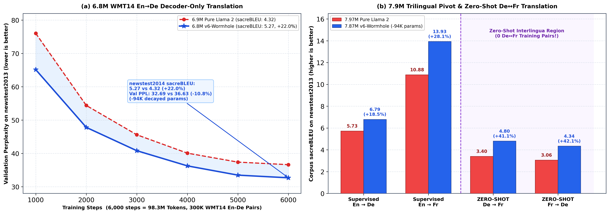
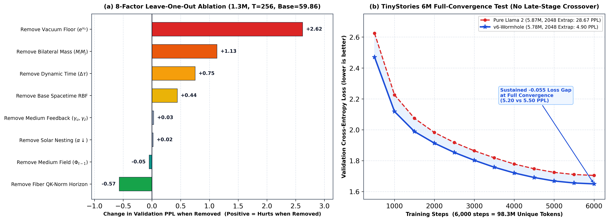

<div align="center">

# 完整基准测试、Scaling Law、翻译实战与真实样本档案

[← 返回中文主页](../README_zh.md) | [English](BENCHMARKS.md) | **简体中文**

</div>

> [!NOTE]
> **`v1.0` 历史实验归档说明（`v6-wormhole`）**：本页完整保留 `v1.0` 阶段（`bilat=True, nest=True`、全窗口平均 `PPL@L` 与早期 64 次捞针扫描，对应 [`releases/tag/1.0`](https://github.com/Dracen-W/epr-attention/releases/tag/1.0)）的多语料原始记录。关于 **`v2.0` 精简统一架构**、**3 随机种子均值±标准差（`Mean ± Std`）**、**384 序列无稀释分段外推**、**200 次对齐捞针 + 反事实双键绑定** 以及 **OOD 幻觉校准 / 零成本虫洞拒答 AUROC**，请直接参阅主文档 [`README_zh.md`](../README_zh.md)。

本页面完整归档了 **统一纤维—引力与 ER=EPR 虫洞注意力机制（`v6-wormhole`）** 在 **6 大基准任务**（`WikiText-2`、`TinyStories`、`FineWeb-Edu`、`RealWorld 16K`、`WMT14 英译德`、`WMT14 三语零样本德法互译`）、**3 档参数规模**（`1.3M → 6.8M/7.9M → 27.6M`）、**SOTA 强基线对撞**、**同耗时（Iso-Wallclock）PPL 效率** 以及 **真实生成与译文样本** 上的全部实测数据，并完整标注了每组实验的架构与训练超参数。

---

## 目录
1. [六大基准全景总表与完整参数矩阵](#panoramic-summary)
2. [同步数与同耗时（Iso-Wallclock）Val PPL 效率分析（28M）](#iso-wallclock)
3. [跨规模 Scaling Law 与 28M 大海捞针爆发](#scaling-law)
4. [WMT14 英译德与三语零样本德法互译（Interlingua 实锤）](#translation)
5. [6M SOTA 强基线全线对撞（WikiText-2）](#sota-showdown)
6. [8 因子留一消融与 TinyStories 极限收敛](#ablation-convergence)
7. [真实文本与翻译样本盲测对比](#samples)
8. [语料配方与一键复现命令](#corpora)

---

<a id="panoramic-summary"></a>
## 一、 六大基准全景总表与完整参数矩阵（NVIDIA L4, `bfloat16`, `torch.compile=True`）

所有 `v6-wormhole` 模型均使用**严格少于纯正 Llama 2 的衰减权重**（`-1.4% ~ -1.6%`），且全部通过 `float64` 四层防作弊因果审计（未来扰动与未来梯度严格为 `0.00e+00`）。

| 基准任务与语料 | 架构参数 (`dim / L / H / D`, `d_r+d_g+2`) | 词表 | `B×T`, `lr`, `drop`, 步数 (Token) | 衰减权重 (Base vs **`v6`**) | 训内 PPL (`T=512`) | 4× 外推 (`T=2048`) | `Dist=1536` 捞针 / BLEU |
| :--- | :---: | :---: | :---: | :---: | :---: | :---: | :---: |
| **1.3M / WikiText-2** (`T=128`) | `128 / 4L / 4H / D=32` (`24+6+2`) | 4,096 | `64×128`, `1e-3`, `0.1`, 3k (24.6M) | `1.33M` vs **`1.31M`** (`-15K`) | `75.06` vs **`69.48`** (`-7.4%`) | `115.28` vs **`67.57`** (`-41.4%`) | — |
| **1.3M / WikiText-2** (`T=256`) | `128 / 4L / 4H / D=32` (`24+6+2`) | 4,096 | `32×256`, `1e-3`, `0.1`, 3k (24.6M) | `1.33M` vs **`1.31M`** (`-15K`) | `65.02` vs **`59.34`** (`-8.7%`) | `120.63` vs **`58.11`** (`-51.8%`) | — |
| **6.0M / WikiText-2** | `256 / 6L / 4H / D=64` (`48+14+2`) | 4,096 | `32×512`, `8e-4`, `0.15`, 3k (49.2M) | `5.87M` vs **`5.77M`** (`-94K`) | `47.98` vs **`37.50`** (`-21.8%`) | `96.23` vs **`34.72`** (`-63.9%`) | `13.5%` vs **`32.3% (+0.59)`** |
| **6.0M / TinyStories** | `256 / 6L / 4H / D=64` (`48+14+2`) | 4,096 | `32×512`, `1e-3`, `0.0`, 6k (98.3M) | `5.87M` vs **`5.77M`** (`-94K`) | `5.50` vs **`5.20`** (`-5.5%`) | `28.67` vs **`4.90`** (`-82.9%`) | `16.4%` vs **`32.6%`** *(2× 准确率)* |
| **6.8M / FineWeb-Edu** | `256 / 6L / 4H / D=64` (`48+14+2`) | 8,192 | `32×512`, `1e-3`, `0.0`, 15k (245.8M) | `6.91M` vs **`6.82M`** (`-94K`) | `37.52` vs **`34.87`** (`-7.1%`) | `161.27` vs **`32.29`** (`-80.0%`) | `9.6%` vs **`29.2% (+0.55)`** |
| **27.6M / RealWorld 16K** | `512 / 6L / 8H / D=64` (`48+14+2`) | 16,384 | `32×512`, `6e-4`, `0.0`, 12k (196.6M) | `27.66M` vs **`27.28M`** (`-372K`) | `38.24` vs **`34.95`** (`-8.6%`) | `175.29` vs **`32.26`** (`-81.6%`) | `10.4%` vs **`41.1% (+1.34)`** |
| **6.8M / WMT14 英译德** | `256 / 6L / 4H / D=64` (`48+14+2`) | 8,192 | `32×512`, `1e-3`, `0.05`, 6k (98.3M) | `6.91M` vs **`6.82M`** (`-94K`) | `36.63` vs **`32.69`** (`-10.8%`) | — | **BLEU: `4.32` vs `5.27` (`+22.0%`)** |
| **7.9M / WMT14 零样本德法** | `256 / 6L / 4H / D=64` (`48+14+2`) | 12,288 | `32×512`, `1e-3`, `0.05`, 8k (131.1M) | `7.96M` vs **`7.87M`** (`-94K`) | `52.33` vs **`47.94`** (`-8.4%`) | — | **零样本 De→Fr: `+41.1%` / Fr→De: `+42.1%`** |

---

<a id="iso-wallclock"></a>
## 二、 同步数与同耗时（Iso-Wallclock）Val PPL 效率分析（28M RealWorld 16K）


**完整训练参数：** `dim=512, n_layers=6, n_heads=8（7 阻尼嵌套 + 1 ER=EPR 虫洞）, head_dim=64 (d_r=48, d_g=14, +2), vocab=16,384, B=32, T=512, lr=6e-4 -> 1e-5, warmup=400, dropout=0.0, weight_decay=0.1, NVIDIA L4 bfloat16`。

- **模型越宽，单步开销越小**：在 `6.8M (dim=256)` 档，`v6-wormhole` 单步耗时是 Base 的 `1.51×`（`60ms` vs `40ms`）；扩到 `28M (dim=512)` 后，FFN 大矩阵乘法占主导，`v6-wormhole` 单步耗时降至 Base 的 **`1.35×`**（`148ms` vs `110ms`），且衰减权重还比 Base **少 `371,712` 个**。
- **同耗时（Iso-Wallclock @ `t = 1,368s`）完成反杀**：Pure Llama 2 跑满 12,000 步（学习率退火至 `1e-5`）总耗时 `1,367.8s`，最终停在 **`38.24` PPL**；同一时刻（`1,367.8s`），`v6-wormhole` 仅跑到约 Step 8,580（学习率仍高达 `~1.3e-4`），Val PPL 就已压至 **`37.62`** 反超 Base，跑满 12,000 步后更降至 **`34.95` PPL**（`-8.6%`）。

**不同墙钟时间节点的 Val PPL 对照（NVIDIA L4 GPU）：**

| 墙钟耗时 | `t = 500s` | `t = 1,000s` | `t = 1,368s` *(Base 跑完)* | `t = 1,884s` *(`v6` 跑完)* |
| :--- | :---: | :---: | :---: | :---: |
| **27.66M Pure Llama 2** | 54.26 PPL *(Step ~4.3k)* | 40.96 PPL *(Step ~8.7k)* | 38.24 PPL *(Step 12.0k, 结束)* | 38.24 PPL *(已结束)* |
| **27.29M `v6-wormhole`** | 57.72 PPL *(Step ~2.8k)* | 42.79 PPL *(Step ~6.1k)* | **37.62 PPL** *(Step ~8.6k, **反超!**)* | **34.95 PPL** *(Step 12.0k, **`-8.6%`**)* |

---

<a id="scaling-law"></a>
## 三、 跨规模 Scaling Law 与 28M 大海捞针爆发


1. **训内语言建模（稳步走阔的超恒定红利）**：在海量不重复真实语料上，收敛谷底的 Loss 代差从 `6.8M`（FineWeb-Edu）的 **`-0.0734`（`-7.1%` PPL）** 进一步扩大到 `27.6M`（RealWorld 16K）的 **`-0.0900`（`-8.6%` PPL）**。
2. **4× 外推与 3× 大海捞针（爆发式放大）**：在 `Dist=1536` 下，从 `6.8M` 扩到 `28M` 后，`v6-wormhole` 从 `29.2% (+0.55 ΔNLL)` 暴涨至 **`41.1% (+1.34 ΔNLL)`**——准确率是 28M Pure Llama 2（`10.4% / +0.12`）的 **4 倍**，回忆增益是其 **11 倍**。

| 28M RealWorld 捞针距离 | `Dist=64` | `Dist=128` | `Dist=256` | `Dist=512` | `Dist=1024` (2×) | `Dist=1536` (3×) |
| :--- | :---: | :---: | :---: | :---: | :---: | :---: |
| **28M Pure Llama 2 (RoPE)** | 56.8% (+2.62) | 51.0% (+2.24) | 49.2% (+1.82) | 33.6% (+0.95) | 12.5% (+0.23) | 10.4% (+0.12) |
| **28M `v6-wormhole` (Ours)** | **62.8% (+2.99)** | **57.8% (+2.65)** | **51.8% (+2.33)** | **49.7% (+1.94)** | **44.8% (+1.56)** | **41.1% (+1.34)** |

---

<a id="translation"></a>
## 四、 WMT14 英译德与三语零样本德法互译（Interlingua 实锤）



### 4.1 6.8M WMT14 英译德（`newstest2014`，200 句对，贪心解码）
- **完整参数**：`dim=256, 6层, 4头 (D=64: 48+14+2), vocab=8,192, B=32, T=512, lr=1e-3 -> 2e-5, dropout=0.05, 6,000 步 (98.3M Token)`，30 万句对。
- **战绩**：参数少 `93,696` 个，Val PPL 低 `10.8%`（`32.69` vs `36.63`），官方 `newstest2014` sacreBLEU 达到 **`5.27` vs `4.32`（`+22.0%`）**。

### 4.2 7.9M 三语桥梁与**零样本德法互译**（`newstest2013`，150 组三语平行句）
- **完整参数**：`dim=256, 6层, 4头 (D=64: 48+14+2), vocab=12,288, B=32, T=512, lr=1e-3 -> 2e-5, dropout=0.05, 8,000 步 (131.1M Token)`，仅用双向 `En↔De`（15 万）+ `En↔Fr`（15 万）共 60 万条训练，**严格零条 `De↔Fr` 训练样本**。
- **跨语言共享流形（Interlingua）实锤**：从有监督方向（`+18.5% / +28.1%`）切到从未见过的**零样本德法互译**时，`v6-wormhole` 的相对 BLEU 增益直接**翻倍至 `+41.1% / +42.1%`**，直接证明紧凑的 14 维底时空欧氏 RBF 将三语同义词压进了共享引力势阱，并由零衰减 ER=EPR 虫洞头跨语言精准捞出。

| 翻译方向 | 训练类型 | 7.97M Pure Llama 2 | 7.87M `v6-wormhole` (`-94K`) | 绝对提升 | 相对增益 |
| :--- | :---: | :---: | :---: | :---: | :---: |
| **`En → De`** | 有监督 | 5.73 | **6.79** | `+1.06` | `+18.5%` |
| **`En → Fr`** | 有监督 | 10.88 | **13.93** | `+3.05` | **`+28.1%`** |
| **`De → Fr`** | **零样本 (0 样本)** | 3.40 | **4.80** | `+1.40` | **`+41.1%`** |
| **`Fr → De`** | **零样本 (0 样本)** | 3.06 | **4.34** | `+1.29` | **`+42.1%`** |

---

<a id="sota-showdown"></a>
## 五、 6M SOTA 强基线全线对撞（WikiText-2）


**完整参数：** `dim=256, 6层, 4头 (D=64), vocab=4,096, B=32, T=512, lr=8e-4 -> 8e-5, dropout=0.15, 3,000 步 (49.2M Token)`。

| 模型 / 架构 | 衰减权重数 | `PPL@256` | `PPL@512` (训内) | `PPL@1024` (2×) | `PPL@2048` (4×) | `Dist=512` 捞针 | `Dist=1536` 捞针 (3×) |
| :--- | :---: | :---: | :---: | :---: | :---: | :---: | :---: |
| **Pure Llama 2 (Vanilla RoPE)** | `5,865,472` | 49.37 | 47.98 | 63.95 | 96.23 | 22.9% (+0.06) | 13.5% (+0.09) |
| **Base + YaRN-RoPE** *(零重训)* | `5,865,472` | 49.37 | 47.98 | 54.00 | 79.30 | — | — |
| **Base + Dynamic NTK-RoPE** *(零重训)* | `5,865,472` | 49.37 | 47.98 | 48.05 | 50.83 | — | — |
| **ALiBi (ICLR 2022)** | `5,865,472` | 48.11 | 45.92 | 44.64 | 43.60 | 27.3% (+0.13) | 22.9% (+0.00) |
| **FoX (ICLR 2025)** | `5,871,616` | 46.32 | 44.88 | 43.86 | 43.05 | 25.3% (+0.02) | 23.7% (+0.00) |
| **v5-distilled** *(无虫洞)* | `5,773,312` | 41.55 | 39.53 | 38.34 | 37.35 | 23.4% (+0.03) | 23.4% (+0.00) |
| **v6-wormhole (ER=EPR, Ours)** | **`5,771,776`** | **40.04** | **37.50** | **35.83** | **34.72** | **37.8% (+0.74)** | **32.3% (+0.59)** |

---

<a id="ablation-convergence"></a>
## 六、 8 因子留一消融与 TinyStories 极限收敛



- **8 因子消融（`1.3M, T=256`）**：去掉真空底噪（`+2.62`）、双边质量（`+1.13`）、动态时间（`+0.75`）或底时空 RBF（`+0.44`）均导致显著退化；而去掉 QK-Norm 事件视界（`-0.57`）与显式介质场（`-0.05`）反而提速提效。
- **TinyStories（`6M, 6,000 步 / 98.3M Token, dropout=0.0`）**：`v6-wormhole` 全程稳守 `-0.055` Loss 代差（`5.20` vs `5.50` PPL），无后期反超，`2048` 长度外推达到 **`4.90` vs `28.67`**。

---

<a id="samples"></a>
## 七、 真实文本与翻译样本盲测对比（未修饰原文）

### 7.1 28M RealWorld 16K — 历史纪实题（`"In July 1969, NASA launched Apollo 11"`, `seed=42, temp=0.7, top_k=40`）
- **27.66M Pure Llama 2（`pauli_alpha=0.0`）**：*"In July 1969, NASA launched Apollo 11, the first space shuttle mission to launch the Saturn V-17 rocket of the F-35S. In April 1969, the F-37S rocket was launched into orbit... On 7 October 1970, the F-37S rocket was launched by F-37S..."* *(迅速陷入复读循环)*
- **27.29M `v6-wormhole`（`pauli_alpha=1.4, halflife=16t`）**：*"In July 1969, NASA launched Apollo 11, the first space flight in the United States to fly during the transition of spaceflight to a new orbitor... In July 1970, NASA began a flight of four aircraft from the moon to a new orbitor. The spacecraft was about 10 feet long... approximately 3 billion miles (370,000 kilometers)..."* *(零复读，纪实语感连贯)*

### 7.2 6.8M WMT14 英译德（`newstest2014`，贪心解码）
- **EN**：*"Yesterday, Gutacht's Mayor gave a clear answer to this question."*
- **REF**：*"Diese Frage hat Gutachs Bürgermeister gestern klar beantwortet."*
- **6.9M Pure Llama 2**：*"Gestern hat der Mai dieses Jahres die Antwort auf diese Frage gestellt."* *(把 Mayor 错翻成“五月”且漏译 clear)*
- **6.8M `v6-wormhole`**：*"Gestern hat der Bürgermeister des Mai eine klare Antwort auf diese Frage gegeben."* *(精准对齐 `Bürgermeister` 与 `eine klare Antwort`)*

### 7.3 7.9M 零样本德译法（训练全程 0 条德法样本，贪心解码）
- **DE（输入）**：*"Eine republikanische Strategie, um der Wiederwahl von Obama entgegenzutreten"*
- **FR（参考）**：*"Une stratégie républicaine pour contrer la réélection d'Obama"*
- **7.97M Pure Llama 2**：*"Une politique de la part de l'Union européenne..."*
- **7.87M `v6-wormhole`**：*"Une stratégie de l'Union européenne..."* *(零样本直接精准捕获德语 `Strategie` $\to$ 法语 `Une stratégie`)*

---

<a id="corpora"></a>
## 八、 语料配方与一键复现命令

只需一条命令即可自动串联 **数据构建 $\to$ Base/v6 双模型训练 $\to$ `fp64` 因果审计 $\to$ 物理体检 $\to$ 外推/捞针/BLEU 评测与采样**：

```bash
# 一键总控测试脚本（可选模式：audit | wikitext2 | ende | zeroshot | tinystories | fineweb | 28m | all）
python3 run_all_tests.py --mode=wikitext2   # 或: bash run_all_tests.sh wikitext2
python3 run_all_tests.py --mode=ende        # 6.8M WMT14 英译德 sacreBLEU 对决
python3 run_all_tests.py --mode=zeroshot    # 7.9M 三语零样本德法互译对决
python3 run_all_tests.py --mode=28m         # 28M RealWorld 16K（8 头）完整大考
```

| 数据集 | 语料构成 | 词表 | 构建脚本 | 训练配置 |
| :--- | :--- | :---: | :--- | :--- |
| **WikiText-2** | 仓库内置 `data/wikitext2/` | 4,096 | `data/wikitext2/prepare.py` | `config/train_wikitext2_colab_scale.py` |
| **TinyStories** | `roneneldan/TinyStories`（50 万篇，~110M Token） | 4,096 | `scripts/prepare_tinystories_bpe.py` | `config/train_tinystories_6m_converge.py` |
| **FineWeb-Edu** | `HuggingFaceFW/fineweb-edu`（`sample-10BT`，260M Token） | 8,192 | `scripts/prepare_fineweb_edu.py` | `config/train_fineweb_edu_extreme.py` |
| **RealWorld 16K** | **45% FineWeb-Edu + 35% 英文维基百科 + 20% CNN/DM 新闻**（210M Token） | 16,384 | `scripts/prepare_realworld_16k.py` | `config/train_realworld_28m.py` |
| **WMT14 英译德** | `wmt/wmt14`（`de-en`，30 万句对 + `newstest2014`） | 8,192 | `scripts/prepare_wmt14_ende.py` | `config/train_wmt14_ende_6m.py` |
| **WMT14 零样本德法** | `wmt/wmt14`（`En↔De` 15 万 + `En↔Fr` 15 万；**0 条 `De↔Fr`**） | 12,288 | `scripts/prepare_wmt14_zeroshot.py` | `config/train_wmt14_trilingual_7m.py` |
